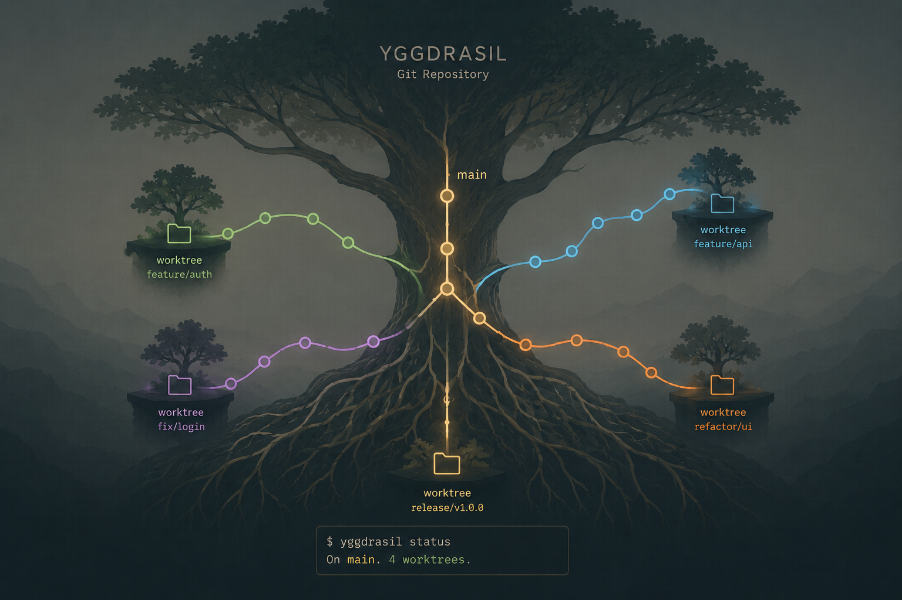
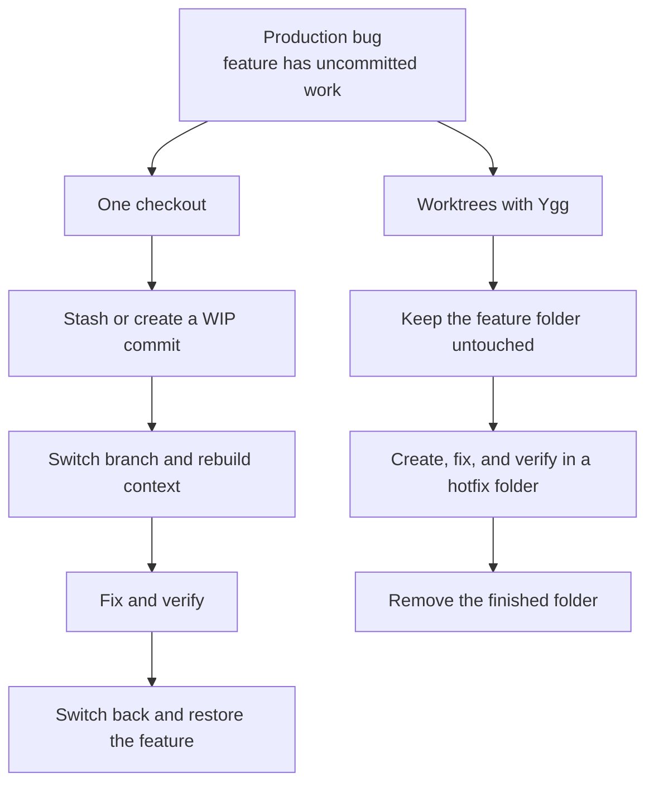

# 🌳 Ygg

**Ygg — Git workspaces, rooted together.**

Keep your feature open. Fix production in parallel. Review a teammate's branch without stashing half
your day away. Ygg turns Git worktrees into tidy, ready-to-use development environments.



## 🌿 Why Ygg?

Ygg is short for **Yggdrasil**, the world tree from Norse mythology. Its roots and trunk hold
different worlds together without turning them into the same place.

That is the idea behind Ygg: one Git repository forms the shared root, while every feature, hotfix,
review, or coding agent grows in its own worktree. Each world gets its own files and processes, but
they all stay connected through the same Git history.

## 🌱 Why worktrees?

Branches are excellent at organizing history, but a normal checkout still gives you only one set of
files at a time. A worktree turns another branch into another real project folder.

[Git worktrees](https://git-scm.com/docs/git-worktree) let one repository support several of these
folders at once. No repeated cloning, no forced context switch, and no need to hide unfinished work
just to look at something else.

When production breaks during unfinished feature work, that changes the workflow:



The useful boundary is simple:

| Shared through Git | Independent in each worktree |
| --- | --- |
| Commits and Git objects | Checked-out files |
| Branches and tags | `HEAD` and index |
| Remotes and fetched refs | Dependencies and build output |
| Stashes and normal repository config | Editors and running processes |

Separate folders isolate files, not external resources. Two development servers may still compete
for the same port or database.

### A quick rule of thumb

| Situation | Best fit |
| --- | --- |
| An urgent task would interrupt unfinished work | Create another worktree. |
| A review or test must run beside current development | Create another worktree. |
| Two editors or agents must not share staged or generated files | Give each one a worktree. |
| One small task is active and switching has no setup cost | A normal branch switch is enough. |

Want a gentler tour through the idea? [Worktrees explained](docs/worktrees.md) walks through the
mental model, real examples, layouts, and common pitfalls.

## 🌲 What Ygg adds

Git already provides the powerful `git worktree` foundation. Ygg takes care of the ceremony around
it: predictable paths, branch resolution, trusted setup, navigation, tools, and safe cleanup.


## 🚀 Get started

Requirements: Node.js 22.13 or newer, pnpm 11, and Git.

Until Ygg is published to npm, install it directly from this repository:

```sh
git clone git@github.com:phillippbertram/ygg-worktree.git
cd ygg-worktree
pnpm install
pnpm run link:global
ygg --help
```

### 1. Set up your workspace

From a remote repository:

```sh
ygg init git@github.com:example/project.git ~/dev/project
```

Or keep an existing checkout exactly where it is and use the guided setup:

```sh
cd ~/dev/project
ygg init
```

Ygg validates the choices, previews absolute paths and the resulting tree, and asks before
initializing anything. See [workspace layouts](docs/worktrees.md#workspace-layouts) for standalone,
grouped, and retained-checkout variants.

### Prefer a guided menu?

Run `ygg` without a command. The menu stays open, refreshes the workspace after every action, and
always brings you back to an up-to-date overview.

| Key or choice | Result |
| --- | --- |
| `Enter` | Accept the highlighted or entered value. |
| `Esc` | Go back one step; at the first prompt cancel the command, and in the main menu exit. |
| `← Back` | Visible equivalent to `Esc` in nested single-choice menus. |
| `Ctrl-C` | Exit Ygg immediately with status 130. |

Previous answers remain selected when moving back. Choosing `No`, submitting empty text, or making
an empty checkbox selection keeps its normal meaning and is not treated as `Esc`. Once a workspace
or worktree has been created, navigation never rolls that change back; cancelling optional setup
instead prints what remains and how to continue later.

### 2. Add your first worktrees

```sh
cd ~/dev/project
ygg create main --cd
ygg create feature/payment --tool code
```

The recommended flat workspace is easy to scan:

```text
project/
├── .ygg/                    local Ygg configuration and shared files
├── repo.git/                shared Git repository, no files checked out here
├── main/                    main branch worktree
└── feature-payment/         feature/payment branch worktree
```

Branch separators become hyphens in default directory names. Use `ygg list` to see the exact branch,
state, and path of every worktree.

### 3. Work, verify, and tidy up

```sh
ygg list
ygg run verify feature-payment
ygg remove feature-payment
```

`ygg run verify` is available when the repository defines that task in `.ygg.yml`. Removal checks
for modified files, unmerged work, and locks before deleting the linked checkout. It never deletes
the branch. If project setup failed during creation, fix the cause and retry it with `ygg setup
feature-payment`.

## 🌿 Pick the workflow that fits your day

| Goal | Create | Finish |
| --- | --- | --- |
| Fix production beside unfinished work | `ygg create hotfix/payment --from release/1.x --tool code` | `ygg remove hotfix-payment` |
| Review a remote branch locally | `ygg create contributor/payment-fix --tool code` | Run the configured checks, then remove it |
| Run a long test beside development | `ygg create experiment/migration --cd` | Remove it after the experiment |
| Give two agents separate files | `ygg create feature/api` and `ygg create feature/ui` | Open each agent in a separate terminal; verify and remove independently |

Ygg reuses a local branch, tracks a matching branch from the configured remote, or creates a new
branch from the default branch. Use `--from HEAD` only when new work should start from the current
worktree's exact commit.

## Move between worktrees without friction

Shell integration lets `ygg cd` and `ygg create --cd` take you straight to the selected worktree:

```sh
# zsh
eval "$(ygg completion zsh)"

# bash
eval "$(ygg completion bash)"

# fish
ygg completion fish | source
```

Add the matching line to your shell configuration once and navigation feels just like a built-in
shell command. Without it, `ygg cd` still prints the canonical path and `ygg create --cd` prints a
normal `cd` fallback.

## Make every worktree feel ready

A repository can commit `.ygg.yml` so a fresh worktree does not feel half-finished. Install
dependencies, copy or link local files, expose named tasks, and define editor or agent profiles once
for the whole project.

```sh
ygg config init
git diff -- .ygg.yml
ygg config trust
```

See [Configuration](docs/configuration.md) for the YAML schema, local shared files, lifecycle hooks,
tasks, tools, and trust model. Ygg always asks you to review and trust executable project behavior
locally before running it.

## Clean up with confidence

| Goal | Command | Result |
| --- | --- | --- |
| Finish with an existing worktree | `ygg remove feature-payment` | Removes the checkout directory, never the branch. |
| Inspect metadata for a directory deleted outside Git | `ygg prune` | Preview only; changes nothing. |
| Apply that metadata cleanup | `ygg prune --apply` | Removes only stale Git worktree registrations. |

Let Ygg do the tidying instead of moving or deleting linked worktree folders manually. `ygg remove`
checks their state first; `ygg prune` is the recovery path for administrative metadata after a
folder is already missing.

## Keep exploring

- [Worktrees explained](docs/worktrees.md): mental model, visual workflows, layouts, and pitfalls.
- [CLI reference](docs/cli-reference.md): every command, argument, option, and non-interactive rule.
- [Configuration](docs/configuration.md): YAML schema, trust model, hooks, tasks, files, and tools.
- [Agent workflows](docs/agent-workflows.md): isolated worktrees for coding agents.
- [Roadmap](docs/roadmap.md): intentionally deferred capabilities.

## ☕ Support Ygg

If Ygg saves you a few stashes, context switches, or accidental branch mix-ups, you can support its
development with a coffee:

<a href="https://www.buymeacoffee.com/phillippbertram" target="_blank">
  
</a>

## Build Ygg with us

```sh
pnpm lint
pnpm typecheck
pnpm test
pnpm build
```

Remove the global source link with `pnpm run unlink:global`. To explore the CLI without installing
it globally, use `pnpm dev -- --help`.

Ygg is a clean rename of the earlier private `worktree-cli` prototype. Legacy `.wt` workspaces and
`.wt.yml` files are not migrated automatically.

## License

[MIT](LICENSE)
