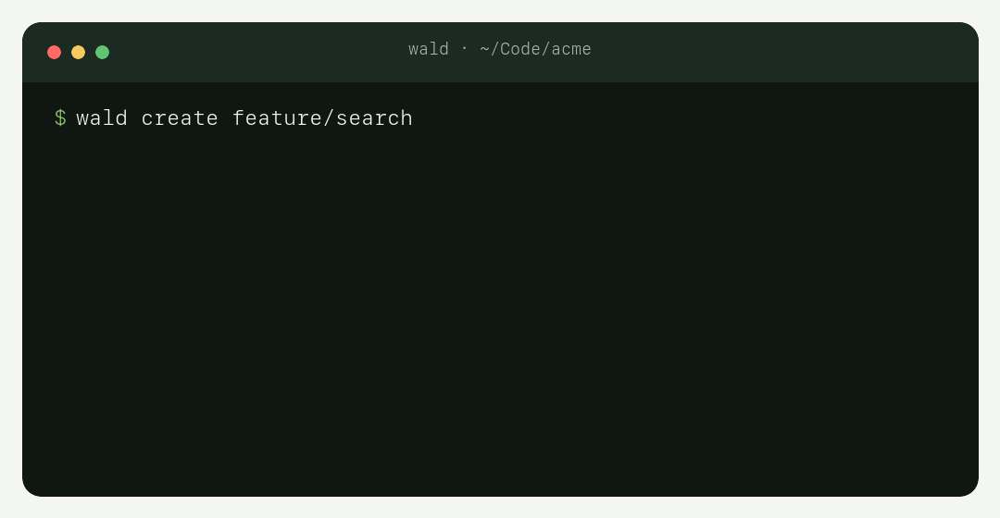

# 🌲 Wald — Git Worktrees CLI

[](https://github.com/phillippbertram/wald-worktree/actions/workflows/ci.yml)
[](LICENSE)
[](package.json)
[](docs/cli-reference.md)

**Wald — Where Git worktrees grow.**

Git can create another checkout in one command. The rest is usually up to you: choose a path,
install dependencies, bring over local files, and open the right editor. Wald handles that repeatable
setup, so unfinished feature work can stay put while you fix a bug, review a pull request, or give a
coding agent its own folder.


## The setup around a worktree

A plain Git worktree gives you another set of checked-out files. For most projects, a few more steps
follow:

```sh
git worktree add ../feature-payment -b feature/payment origin/main
cd ../feature-payment
pnpm install
cp ../main/.env.local .env.local
code .
```

Once you have trusted the project's setup, the same job becomes:

```sh
wald create feature/payment --tool code
```

Wald resolves the branch, chooses the path, creates the worktree, and runs the trusted setup. It can
also copy or link configured local files and open your editor or agent. `wald plant` is an exact alias
for `wald create`.



## Why worktrees?

A branch separates Git history. A worktree also separates the files, index, dependencies, editor,
and running processes you use for that branch. Your unfinished feature can stay open while you fix
production, review a pull request, or give an agent an isolated folder.

All worktrees still share one repository's objects, refs, remotes, and history. Git remains the
source of truth; Wald handles worktree paths, setup, and removal around it.

| When this happens                     | Instead of                     | Use                    |
| ------------------------------------- | ------------------------------ | ---------------------- |
| Production breaks during feature work | Stash, switch, rebuild context | A hotfix worktree      |
| A review needs a clean checkout       | Disturb your current index     | A review worktree      |
| A long test must run in parallel      | Wait or duplicate the clone    | An experiment worktree |
| Two agents need the same repository   | Share files and staging state  | One worktree per agent |

New to the idea? Start with [Worktrees explained](docs/worktrees.md).

## What Wald adds to Git

- Runs trusted lifecycle hooks to install dependencies and copy or link local files.
- Gives each worktree a stable path and shows the exact location in `wald status` and `wald list`.
- Checks for local changes, locks, unmerged branches, and protected primary checkouts before removal.
- Exposes named tasks, tool profiles, JSON output, and code-only handoffs for terminals, scripts, and
  coding agents.

Wald does not replace branches, invent a second repository model, or hide Git state. You can keep
using `git status`, `git log`, commits, merges, and pushes exactly as before.

## Get started

Wald supports macOS and Linux and requires Node.js 22.13.0 or newer and Git 2.31.0 or newer. Building
from source uses pnpm 11.15.1.

Until Wald is published to npm, install it from this repository:

```sh
git clone git@github.com:phillippbertram/wald-worktree.git
cd wald-worktree
pnpm install
pnpm run install:global
wald --help
```

### Keep an existing checkout

Run the guided setup inside a repository you already use:

```sh
cd ~/dev/project
wald init
```

Before writing workspace metadata, Wald shows the proposed layout and asks for confirmation. Your
existing checkout stays where it is and remains protected as the primary worktree.

### Start from a remote repository

```sh
wald init git@github.com:example/project.git ~/dev/project
```

Wald creates the standalone layout, then offers to create the first worktree and configure the
project.

### Create your first workspace

```sh
wald create feature/payment --cd
wald create hotfix/payment --from release/1.x --tool code
wald create feature/review --tool codex
```

Wald reuses a local branch, tracks a matching remote branch, or creates a new branch from the
configured default branch. Add `--from HEAD` when new work should begin at the current commit.

## A typical day

```sh
wald status
wald list
wald create feature/search --cd
wald run verify feature-search
wald remove feature-search
```

`wald status` is a read-only summary of the current workspace. `wald list` shows every checkout and
its exact path. `wald remove` checks local changes, locks, and merge state before removing a linked
checkout; it keeps the branch unless you explicitly request eligible branch deletion.

Need to move unfinished code into a clean branch? `wald handoff feature/review` carries staged,
unstaged, and non-ignored untracked file contents into a new worktree while leaving the source
unchanged. It transfers code, not a running editor, process, or agent session.

## Wald Flow

Wald Flow is the recommended physical layout. It is not a branching or release strategy.

```text
project/
├── .wald/
│   ├── workspace.yml        local layout and trust
│   ├── project.yml          local automation and overrides
│   └── shared/              local files shared with worktrees
├── repo.git/                shared Git repository
├── main/                    main branch worktree
└── feature-payment/         feature/payment worktree
```

You can also keep an existing checkout where it is or group worktrees in a subdirectory. See
[Workspace layouts](docs/worktrees.md#workspace-layouts).

## Project setup in every worktree

```sh
wald config init
wald config trust
```

Put repeated setup in the project configuration: install dependencies, copy or link files, run
lifecycle hooks, and define named tasks or editor profiles. Wald stores local automation in
`.wald/project.yml` by default; teams can deliberately share a repository-owned `.wald.yml`.

Wald never runs executable project behavior without local trust. Review the effective configuration,
trust it locally, and use `wald config untrust` to revoke that decision. The complete schema and
precedence rules live in [Configuration](docs/configuration.md).

## Shell integration

Load completion and directory navigation once in your shell profile:

```sh
# zsh
eval "$(wald completion zsh)"
```

Bash and Fish are supported too. With integration loaded, `wald cd`, `wald create --cd`, and
`wald handoff --cd` can change the current shell directory. Without it, Wald prints the canonical
path and a normal `cd` fallback. See [Shell integration](docs/cli-reference.md#wald-completion).

## One worktree per coding agent

```sh
wald create feature/api --tool codex
wald create feature/ui --tool codex-app
wald list
```

Each agent gets its own index and working directory while commits and refs remain shared. Give each
branch a clear owner, run the configured checks in that worktree, and merge through your normal Git
workflow. [Agent workflows](docs/agent-workflows.md) covers the details.

## Learn more

- [Worktrees explained](docs/worktrees.md) — mental model, Wald Flow, workflows, and pitfalls.
- [Configuration](docs/configuration.md) — setup, files, hooks, tasks, tools, and trust.
- [Agent workflows](docs/agent-workflows.md) — isolated workspaces for parallel coding agents.
- [Roadmap](docs/roadmap.md) — implemented scope and intentionally deferred capabilities.
- [Brand identity](docs/brand.md) — Wald's name, voice, visual language, and public naming.
- [CLI reference](docs/cli-reference.md) — every command, flag, JSON contract, and safety rule.

## Contributing

Issues and focused pull requests are welcome. Read [Contributing](CONTRIBUTING.md) and run the
project checks before opening a pull request:

```sh
pnpm run ci
```

If Wald saves you a few stashes or context switches, you can also buy me a coffee ☕️😇

<a href="https://www.buymeacoffee.com/phillippbertram" target="_blank">
  
</a>

## License

[MIT](LICENSE)
