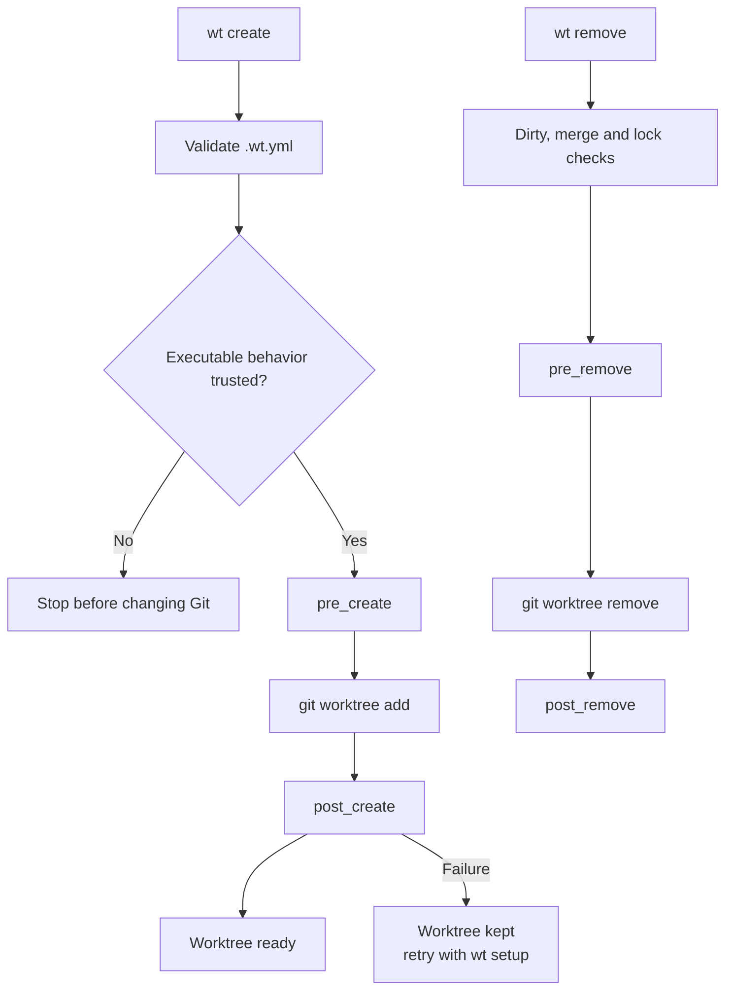

# worktree-cli

`wt` is a configurable Git worktree and agent workflow CLI. It keeps Git as the source of truth,
adds a searchable interactive terminal UI, and gives scripts the same capabilities through direct
commands.

The v1 contract is a clean break: configuration is YAML-only and previous command or configuration
formats are not supported.

## Highlights

- Create, find, inspect, enter, open, and safely remove Git worktrees.
- Adopt an existing repository without moving it or changing its Git configuration.
- Bootstrap ignored files and shared directories through explicit copy or symlink steps.
- Configure lifecycle hooks and named tasks in a committed `.wt.yml`.
- Run commands as argument arrays by default; shell evaluation is always explicit.
- Trust executable project configuration by its semantic SHA-256 hash.
- Open worktrees in editors and agents through built-in or custom tool profiles.
- Install a portable Agent Skill from [`skills/wt-worktrees`](skills/wt-worktrees/SKILL.md).
- Guide interactive input with Inquirer and present progress and status with concise colored output.

## Requirements and installation

- Node.js 22.13 or newer
- pnpm 11
- Git

```sh
pnpm install
pnpm run link:global
wt --help
```

For development without a global link:

```sh
pnpm dev -- --help
```

## Quickstart

Adopt the current checkout:

```sh
cd ~/dev/project
wt init
```

Or create a dedicated workspace backed by a bare clone:

```sh
wt init git@github.com:example/project.git ~/dev/project
cd ~/dev/project
wt create main
wt create feature/payment
```

Run `wt` without arguments for the interactive menu. Direct commands remain deterministic for
scripts and agents:

```sh
wt list
wt cd feature-payment
wt exec feature-payment -- pnpm test
wt run verify feature-payment
wt create feature/review --tool codex
wt remove feature-payment --yes
```

Create a repository-owned configuration through project detection and guided prompts:

```sh
wt config init
wt config
wt config trust
```

Enable navigation and dynamic completion in the current shell:

```sh
# zsh
eval "$(wt shell-init zsh)"

# bash
eval "$(wt shell-init bash)"

# fish
wt shell-init fish | source
```

The wrapper makes `wt cd <worktree>` and `wt create <branch> --cd` change the parent shell's
directory. Without it, both commands print or create the path without attempting the impossible
parent-shell mutation.

## Commands

| Command                               | Purpose                                                     |
| ------------------------------------- | ----------------------------------------------------------- |
| `wt init`                             | Interactively adopt the current Git repository.             |
| `wt init --adopt <path> --yes`        | Adopt a repository non-interactively.                       |
| `wt init <repository> [directory]`    | Create a managed bare workspace.                            |
| `wt create [branch]`                  | Create a worktree, run setup, and optionally open a tool.   |
| `wt list`                             | Show every worktree and its state.                          |
| `wt cd [worktree]`                    | Enter a worktree with shell integration, or print its path. |
| `wt open [worktree] --tool <profile>` | Open an editor or start an agent.                           |
| `wt exec [worktree] -- <command>`     | Execute an argument-safe command in a worktree.             |
| `wt run [task] [worktree]`            | Run a named `.wt.yml` task.                                 |
| `wt setup [worktree]`                 | Re-run the configured post-create setup.                    |
| `wt remove [worktrees...] --yes`      | Safely remove one or several worktrees.                     |
| `wt config init [worktree]`           | Generate `.wt.yml` from detected project conventions.       |
| `wt config`                           | Show and validate local/project YAML configuration.         |
| `wt config trust\|untrust`            | Control project configuration trust.                        |
| `wt shell-init bash\|zsh\|fish`       | Generate navigation and completion integration.             |

Use `wt <command> --help` for options. JSON output is available where it is a data interface, such
as `wt list --json`; JSON is not a configuration format.

## Configuration and automation

`wt` uses two YAML files with separate ownership:

- `.wt/workspace.yml` for a dedicated workspace, or `<git-common-dir>/wt/workspace.yml` for an
  adopted repository. It stores local paths, remote/default-branch selection, and the trusted
  project configuration hash.
- `.wt.yml` in the repository. It is committed and may define defaults, lifecycle hooks, named
  tasks, and tool profiles.

`.yml` is the only v1 filename convention; `.yaml` aliases are intentionally not read.

For an existing checkout, `wt init` offers to generate `.wt.yml` after adoption. The deterministic
equivalent is:

```sh
wt init --adopt . --yes --config
```

For a managed bare workspace, first create a checkout and then initialize its configuration:

```sh
wt create main
wt config init main
```

The wizard detects the package manager, an environment example, available package scripts, and a
default editor or agent. `wt config init --yes` accepts the detected defaults without prompts;
replacing an existing file additionally requires `--force`.



A minimal project configuration:

```yaml
version: 1

defaults:
  fetch: true
  tool: codex

hooks:
  post_create:
    - type: command
      argv: [pnpm, install, --frozen-lockfile]
    - type: copy
      source: default
      from: .env.example
      to: .env
      optional: true

tasks:
  verify:
    description: Run the local quality gate
    steps:
      - type: command
        argv: [pnpm, lint]
      - type: command
        argv: [pnpm, test]

tools:
  review-agent:
    description: Start the repository review agent
    command: [codex, --profile, review]
    mode: foreground
```

See [configuration](docs/configuration.md) for a complete hooks/tasks example and the lifecycle, and
[agent workflows](docs/agent-workflows.md) for tool profiles and the packaged skill.

## Trust and safety

Hooks, tasks, and custom tools can execute code. Before the first configured action, `wt` shows the
behavior it found and requires trust. In a non-interactive terminal:

```sh
wt config
wt config trust --yes
```

Trust is tied to normalized behavior, not YAML formatting: comments and key order do not invalidate
it, while changed commands, hooks, tasks, or tools do. A worktree is created only after `pre_create`
succeeds. If `post_create` or opening a requested tool fails, the worktree is intentionally kept
and the error identifies the recoverable state. Run `wt setup <worktree>` to retry setup.

`wt remove` refuses dirty, unmerged, and locked worktrees unless `--force` is explicit. The primary
checkout of an adopted repository can never be removed by `wt`. Branches are not deleted.

## CLI architecture

Commander owns routing, help, usage errors, and option collection. Each command lives in
`src/cli/commands/` and validates its arguments and options with a command-specific Zod schema
before calling services. YAML configuration uses the same boundary rule: strict Zod schemas apply
defaults and reject unknown fields before domain logic sees the data.

Interactive prompts use `@inquirer/prompts`, progress uses Ora, status and table output uses
Picocolors, and child processes use Execa. Colors and spinners are TTY-aware so redirected output
remains suitable for scripts.

## Development

```sh
pnpm lint
pnpm typecheck
pnpm test
pnpm build
```

See [CONTRIBUTING.md](CONTRIBUTING.md), [SECURITY.md](SECURITY.md), and the
[roadmap](docs/roadmap.md).

## License

[MIT](LICENSE)
