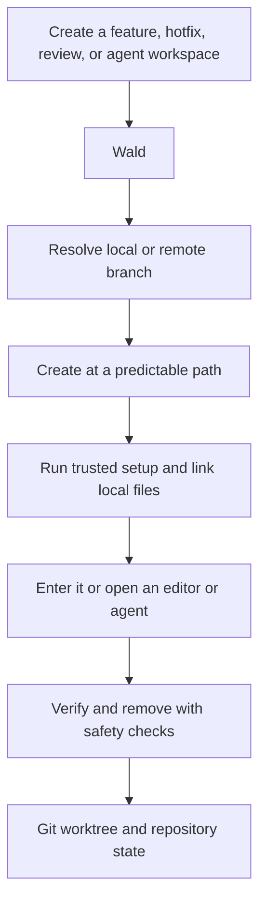

# 🌲 Wald — Git Worktrees CLI

**Wald — Where Git worktrees grow.**

**Git worktrees, ready for real work.**

Git creates another checkout. Wald turns it into a predictable, prepared, and safely managed
development workspace.

With plain Git, starting parallel work often means several manual steps:

```sh
git worktree add ../feature-payment -b feature/payment origin/main
cd ../feature-payment
pnpm install
cp ../main/.env.local .env.local
code .
```

With Wald and trusted project setup:

```sh
wald create feature/payment --tool code
```

Prefer the forest shorthand? `wald plant` is an exact alias for `wald create`:

```sh
wald plant feature/payment --tool code
```

Wald resolves the branch, chooses a predictable path, creates the worktree, links or copies local
files, runs trusted lifecycle hooks, and opens the configured tool.

- **Ready from the start** — Install dependencies and provide local files through trusted setup.
- **Safe through the lifecycle** — Preview changes, trust executable configuration, diagnose
  problems, and remove worktrees with guardrails.
- **Built for parallel work** — Keep stable paths, move between worktrees from the shell, and see the
  complete workspace at a glance.
- **Made for tools and agents** — Use tool profiles, named tasks, JSON output, and code handoffs
  without sharing working files.


## Why Wald?

**Wald** is the German word for forest. The name is short, distinctive, and describes the shape of a
healthy worktree setup: the repository is the shared ground, while every feature, hotfix, review,
or coding agent grows as an independent tree.

Each worktree gets its own files, dependencies, editor, and processes. Under the surface, all of
them remain connected through the same Git history, just as a forest shares one living ground while
every tree has room to grow. The metaphor makes the workspace easy to picture; Git remains the
source of truth.

## Why worktrees?

Branches are excellent at organizing history, but a normal checkout still gives you only one set of
files at a time. A worktree turns another branch into another real project folder.

[Git worktrees](https://git-scm.com/docs/git-worktree) let one repository support several of these
folders at once. No repeated cloning, no forced context switch, and no need to hide unfinished work
just to look at something else.

When production breaks during unfinished feature work, that changes the workflow:


The useful boundary is simple:

| Shared through Git                   | Independent in each worktree  |
| ------------------------------------ | ----------------------------- |
| Commits and Git objects              | Checked-out files             |
| Branches and tags                    | `HEAD` and index              |
| Remotes and fetched refs             | Dependencies and build output |
| Stashes and normal repository config | Editors and running processes |

Separate folders isolate files, not external resources. Two development servers may still compete
for the same port or database.

### A quick rule of thumb

| Situation                                                      | Best fit                          |
| -------------------------------------------------------------- | --------------------------------- |
| An urgent task would interrupt unfinished work                 | Create another worktree.          |
| A review or test must run beside current development           | Create another worktree.          |
| Two editors or agents must not share staged or generated files | Give each one a worktree.         |
| One small task is active and switching has no setup cost       | A normal branch switch is enough. |

Want a gentler tour through the idea? [Worktrees explained](docs/worktrees.md) walks through the
mental model, real examples, layouts, and common pitfalls.

## How Wald builds on Git

Git's native `git worktree` command remains the foundation and source of truth. Wald adds the
workflow around it: predictable paths, branch resolution, trusted setup, navigation, tools, and
safe cleanup.



## Get started

Supported platforms are macOS and Linux with Node.js 22.13.0 or newer, pnpm 11, and Git 2.31.0 or
newer. Git 2.31 is required because Wald uses absolute common-directory resolution introduced with
`git rev-parse --path-format` ([Git 2.31 release notes](https://github.com/git/git/blob/master/Documentation/RelNotes/2.31.0.adoc)).

Until Wald is published to npm, install it directly from this repository:

```sh
git clone git@github.com:phillippbertram/wald-worktree.git
cd wald-worktree
pnpm install
pnpm run install:global
wald --help
```

Wald uses its own metadata namespace and does not detect workspaces created under earlier product
names or provide legacy command aliases. Re-initialize or adopt an existing repository safely with
`wald init`; renaming metadata directories by hand is not a supported upgrade path.

### 1. Set up your workspace

From a remote repository:

```sh
wald init git@github.com:example/project.git ~/dev/project
```

Or keep an existing checkout exactly where it is and use the guided setup:

```sh
cd ~/dev/project
wald init
```

Wald validates the choices, previews absolute paths and the resulting tree, and asks before
initializing anything. See [workspace layouts](docs/worktrees.md#workspace-layouts) for standalone,
grouped, and retained-checkout variants.

### Prefer a guided menu?

Run `wald` without a command. A compact forest welcome, the current workspace overview, and a
changing worktree thought lead into the guided menu. The menu stays open, refreshes the workspace
after every action, and always brings you back to an up-to-date overview. `Esc` goes back or cancels
and `Ctrl-C` exits; the complete navigation contract lives in the
[CLI reference](docs/cli-reference.md#general-behavior).

### 2. Add your first worktrees

```sh
cd ~/dev/project
wald create main --cd
wald create feature/payment --tool code
wald create feature/review --carry
```

The recommended layout is called **[Wald Flow](docs/worktrees.md#wald-flow)**. Unlike git-flow or
GitHub Flow, it does not prescribe branches, merges, or releases. Wald Flow organizes the physical
workspace: the Git database and every worktree live side by side, making the whole forest easy to
scan.

```text
project/
├── .wald/
│   ├── workspace.yml        local workspace layout and trust
│   ├── project.yml          local project automation and overrides
│   └── shared/              local files shared with worktrees
├── repo.git/                shared Git repository, no files checked out here
├── main/                    main branch worktree
└── feature-payment/         feature/payment branch worktree
```

Branch separators become hyphens in default directory names. Use `wald status` for the current
workspace context and `wald list` to see the exact branch, state, and path of every worktree.
Use `wald doctor` for a concise read-only diagnosis of the runtime, configuration, paths, Git
registrations, trust state, configured file sources, and executables. It also works outside a Wald
workspace and suggests safe follow-up commands without fetching or repairing anything.

### 3. Work, verify, and tidy up

```sh
wald status
wald list
wald run verify feature-payment
wald remove feature-payment
```

`wald status` summarizes the current checkout, local upstream comparison, project trust, and workspace
states without fetching or changing anything. It reads local state only: it never consults the
remote or changes the repository. `wald run verify` is available when the effective
project configuration defines that task. Removal checks for local changes, a branch not merged
into the configured default branch, and locks before deleting the linked checkout. Branches are
kept by default; an interactive prompt or `--delete-branch` can also delete an eligible local
branch, but never its remote branch. Deleting an unmerged branch additionally requires `--force`.
If project setup failed during creation, fix the cause and retry it with
`wald setup feature-payment`. To test any lifecycle hook after editing
`.wald/project.yml`, run it explicitly without creating or removing a worktree:

```sh
wald hook run post_create feature-payment
```

Repeated setup is safe for an already correct symlink: Wald reports it as `UNCHANGED`. Configure
`on_existing: skip` or `on_existing: replace` explicitly when a different existing target should
be preserved or replaced.

## Pick the workflow that fits your day

| Goal                                  | Create                                                     | Finish                                                                  |
| ------------------------------------- | ---------------------------------------------------------- | ----------------------------------------------------------------------- |
| Fix production beside unfinished work | `wald create hotfix/payment --from release/1.x --tool code` | `wald remove hotfix-payment`                                             |
| Review a remote branch locally        | `wald create contributor/payment-fix --tool code`           | Run the configured checks, then remove it                               |
| Run a long test beside development    | `wald create experiment/migration --cd`                     | Remove it after the experiment                                          |
| Give two agents separate files        | `wald create feature/api` and `wald create feature/ui`       | Open each agent in a separate terminal; verify and remove independently |
| Move unfinished code to a fresh branch | `wald handoff feature/review --tool codex`                  | Continue in the new worktree; the source remains unchanged              |

Wald reuses a local branch, tracks a matching branch from the configured remote, or creates a new
branch from the default branch. Use `--from HEAD` only when new work should start from the current
worktree's exact commit. Use `--carry` instead when the new branch should also receive the current
staged, unstaged, and non-ignored untracked files. `wald handoff` is the guided code-only form of the
same operation; it does not transfer a running editor, process, or agent session. A new local branch
has no upstream even when it starts at `origin/main`; publish it explicitly with the command Wald
prints after creation.

When the branch or handoff target was selected interactively, Wald shows the resolved strategy,
starting ref, target path, carry source, trust state, lifecycle-step counts, and destination before
asking `Create this worktree?`. Declining performs no branch, worktree, trust, or hook mutation. A
fully explicit `wald create <branch>` or `wald handoff <branch>` remains prompt-free.

For automation, `init`, `create`, `handoff`, `rename`, `remove`, and `doctor` accept `--json` in
addition to the existing JSON-capable read and cleanup commands. JSON mode never prompts: provide
all required identifiers and confirmation flags explicitly. Successful lifecycle commands emit one
JSON document on stdout; errors leave stdout empty and emit a redacted JSON error on stderr.

Rename a linked worktree directory without changing its branch:

```sh
wald rename feature-payment payment-review
```

The worktree may be dirty. Wald keeps its branch, `HEAD`, index, and files and refuses primary,
current, external, locked, missing, or submodule-containing worktrees.

## Move between worktrees without friction

Shell integration lets `wald cd`, `wald create --cd`, and `wald handoff --cd` take you straight to the
selected worktree:

```sh
# zsh
eval "$(wald completion zsh)"

# bash
eval "$(wald completion bash)"

# fish
wald completion fish | source
```

Add the matching line to your shell configuration once and navigation feels just like a built-in
shell command. Without it, `wald cd` still prints the canonical path; create and handoff print a
normal `cd` fallback.

## Make every worktree feel ready

By default, Wald keeps project automation outside Git in `.wald/project.yml`. It applies to every
worktree in this Wald workspace and can install dependencies, copy or link local files, expose named
tasks, and define editor or agent profiles.

```sh
wald config init
wald config trust
```

Use `wald config init --scope project` when the team should share a repository-owned `.wald.yml`.
When both files exist, `.wald.yml` is the base and the workspace-local `project.yml` overrides only
the sections it defines.

See [Configuration](docs/configuration.md) for the YAML schema, local shared files, lifecycle hooks,
tasks, tools, and trust model. Wald always asks you to review and trust executable project behavior
locally before running it.

## Clean up with confidence

| Goal                                                  | Command                                        | Result                                                                      |
| ----------------------------------------------------- | ---------------------------------------------- | --------------------------------------------------------------------------- |
| Finish with an existing worktree                      | `wald remove feature-payment`                   | Removes the checkout directory and keeps the branch by default.             |
| Remove its local branch too                           | `wald remove feature-payment --delete-branch`   | Removes the checkout and eligible local branch; keeps the remote branch.    |
| Inspect metadata for a directory deleted outside Git  | `wald prune`                                    | Preview only; changes nothing.                                              |
| Apply that metadata cleanup                           | `wald prune --apply`                            | Removes only stale Git worktree registrations.                              |
| Diagnose runtime and workspace consistency            | `wald doctor`                                   | Reports only; suggests safe repair commands without applying them.           |
| Restore a deleted worktree container or metadata link | `wald init`                                     | Repairs the existing workspace without replacing its configuration.         |
| Inspect removal of Wald from the repository            | `wald uninit`                                   | Previews Wald-owned metadata; keeps Git, branches, and worktree directories. |
| Remove Wald from the repository                        | `wald uninit --apply`                           | Removes only Wald workspace metadata after safety checks.                    |

Let Wald do the tidying instead of moving or deleting linked worktree folders manually. `wald remove`
checks their state first; `wald prune` is the recovery path for administrative metadata after a
folder is already missing. Re-running `wald init` repairs a missing worktree container, `.wald` link,
or shared directory. Removing one worktree keeps its branch and shared history intact. With
`--force`, Wald prints every bypassed safeguard before confirmation; the primary
checkout and worktrees whose state cannot be read remain protected. Use `wald uninit` only when the
repository should stop being managed by Wald. See the
[removal safety matrix](docs/cli-reference.md#wald-remove) for the complete contract.

## Keep exploring

- [Brand identity](docs/brand.md): Wald's name, message, visual language, and tone.
- [Worktrees explained](docs/worktrees.md): Wald Flow, the forest model, workflows, and pitfalls.
- [CLI reference](docs/cli-reference.md): every command, argument, option, and non-interactive rule.
- [Configuration](docs/configuration.md): YAML schema, trust model, hooks, tasks, files, and tools.
- [Agent workflows](docs/agent-workflows.md): isolated worktrees for coding agents.
- [Roadmap](docs/roadmap.md): intentionally deferred capabilities.

## ☕ Support Wald

If Wald saves you a few stashes, context switches, or accidental branch mix-ups, you can support its
development with a coffee:

<a href="https://www.buymeacoffee.com/phillippbertram" target="_blank">
  
</a>

## Build Wald with us

```sh
pnpm lint
pnpm typecheck
pnpm test
pnpm build
```

Remove the global installation with `pnpm run uninstall:global`. To explore the CLI without
installing it globally, use `pnpm dev -- --help`.

## License

[MIT](LICENSE)
