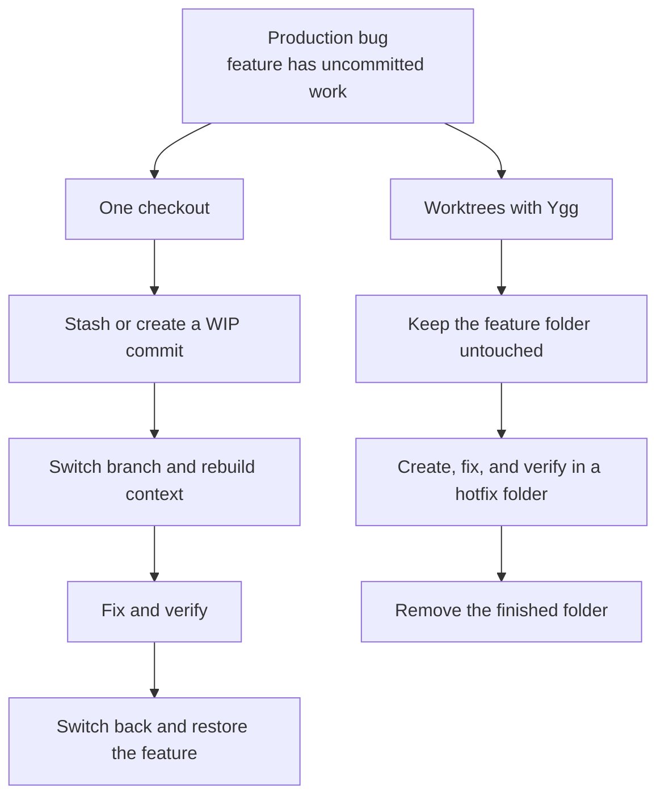

# 🌳 Ygg - Git Worktrees CLI

**Ygg — Git workspaces, rooted together.**

Keep your feature open. Fix production in parallel. Review a teammate's branch without stashing half
your day away. Ygg turns Git worktrees into tidy, ready-to-use development environments.


## Why Ygg?

Ygg is short for **Yggdrasil**, the world tree from Norse mythology. Its roots and trunk hold
different worlds together without turning them into the same place.

That is the idea behind Ygg: one Git repository forms the shared root, while every feature, hotfix,
review, or coding agent grows in its own worktree. Each world gets its own files and processes, but
they all stay connected through the same Git history.

In that mental model, the complete workspace is Yggdrasil, Git's common directory holds the shared
roots (`repo.git` in a standalone workspace), the default branch forms the trunk, and every
worktree is its own world. Ygg keeps the metaphor playful while Git remains the source of truth.

## Why worktrees?

Branches are excellent at organizing history, but a normal checkout still gives you only one set of
files at a time. A worktree turns another branch into another real project folder.

[Git worktrees](https://git-scm.com/docs/git-worktree) let one repository support several of these
folders at once. No repeated cloning, no forced context switch, and no need to hide unfinished work
just to look at something else.

When production breaks during unfinished feature work, that changes the workflow:



The useful boundary is simple:

| Shared through Git                   | Independent in each worktree  |
| ------------------------------------ | ----------------------------- |
| Commits and Git objects              | Checked-out files             |
| Branches and tags                    | `HEAD` and index              |
| Remotes and fetched refs             | Dependencies and build output |
| Stashes and normal repository config | Editors and running processes |

Separate folders isolate files, not external resources. Two development servers may still compete
for the same port or database.

### A quick rule of thumb

| Situation                                                      | Best fit                          |
| -------------------------------------------------------------- | --------------------------------- |
| An urgent task would interrupt unfinished work                 | Create another worktree.          |
| A review or test must run beside current development           | Create another worktree.          |
| Two editors or agents must not share staged or generated files | Give each one a worktree.         |
| One small task is active and switching has no setup cost       | A normal branch switch is enough. |

Want a gentler tour through the idea? [Worktrees explained](docs/worktrees.md) walks through the
mental model, real examples, layouts, and common pitfalls.

## What Ygg adds

Git already provides the powerful `git worktree` foundation. Ygg takes care of the ceremony around
it: predictable paths, branch resolution, trusted setup, navigation, tools, and safe cleanup.


## Get started

Requirements: Node.js 22.13 or newer, pnpm 11, and Git.

Until Ygg is published to npm, install it directly from this repository:

```sh
git clone git@github.com:phillippbertram/ygg-worktree.git
cd ygg-worktree
pnpm install
pnpm run install:global
ygg --help
```

### 1. Set up your workspace

From a remote repository:

```sh
ygg init git@github.com:example/project.git ~/dev/project
```

Or keep an existing checkout exactly where it is and use the guided setup:

```sh
cd ~/dev/project
ygg init
```

Ygg validates the choices, previews absolute paths and the resulting tree, and asks before
initializing anything. See [workspace layouts](docs/worktrees.md#workspace-layouts) for standalone,
grouped, and retained-checkout variants.

### Prefer a guided menu?

Run `ygg` without a command. The menu stays open, refreshes the workspace after every action, and
always brings you back to an up-to-date overview. Prompts show how `Esc` goes back or cancels and
how `Ctrl-C` exits; the complete navigation contract lives in the
[CLI reference](docs/cli-reference.md#general-behavior).

### 2. Add your first worktrees

```sh
cd ~/dev/project
ygg create main --cd
ygg create feature/payment --tool code
ygg create feature/review --carry
```

The recommended layout is called **[Ygg Flow](docs/worktrees.md#ygg-flow)**. Unlike git-flow or
GitHub Flow, it does not prescribe branches, merges, or releases. Ygg Flow organizes the physical
workspace: the Git database and every worktree live side by side, making the whole world tree easy
to scan.

```text
project/
├── .ygg/
│   ├── workspace.yml        local workspace layout and trust
│   ├── project.yml          local project automation and overrides
│   └── shared/              local files shared with worktrees
├── repo.git/                shared Git repository, no files checked out here
├── main/                    main branch worktree
└── feature-payment/         feature/payment branch worktree
```

Branch separators become hyphens in default directory names. Use `ygg status` for the current
workspace context and `ygg list` to see the exact branch, state, and path of every worktree.

### 3. Work, verify, and tidy up

```sh
ygg status
ygg list
ygg run verify feature-payment
ygg remove feature-payment
```

`ygg status` summarizes the current checkout, local upstream comparison, project trust, and workspace
states without fetching or changing anything. Think of it as reading the local runes: it never
consults the remote or changes the repository. `ygg run verify` is available when the effective
project configuration defines that task. Removal checks for local changes, a branch not merged
into the configured default branch, and locks before deleting the linked checkout. Branches are
kept by default; an interactive prompt or `--delete-branch` can also delete an eligible merged
local branch, but never its remote branch. If project setup failed during creation, fix the cause
and retry it with `ygg setup feature-payment`. To test any lifecycle hook after editing
`.ygg/project.yml`, run it explicitly without creating or removing a worktree:

```sh
ygg hook run post_create feature-payment
```

Repeated setup is safe for an already correct symlink: Ygg reports it as `UNCHANGED`. Configure
`on_existing: skip` or `on_existing: replace` explicitly when a different existing target should
be preserved or replaced.

## Pick the workflow that fits your day

| Goal                                  | Create                                                     | Finish                                                                  |
| ------------------------------------- | ---------------------------------------------------------- | ----------------------------------------------------------------------- |
| Fix production beside unfinished work | `ygg create hotfix/payment --from release/1.x --tool code` | `ygg remove hotfix-payment`                                             |
| Review a remote branch locally        | `ygg create contributor/payment-fix --tool code`           | Run the configured checks, then remove it                               |
| Run a long test beside development    | `ygg create experiment/migration --cd`                     | Remove it after the experiment                                          |
| Give two agents separate files        | `ygg create feature/api` and `ygg create feature/ui`       | Open each agent in a separate terminal; verify and remove independently |
| Move unfinished code to a fresh branch | `ygg handoff feature/review --tool codex`                  | Continue in the new worktree; the source remains unchanged              |

Ygg reuses a local branch, tracks a matching branch from the configured remote, or creates a new
branch from the default branch. Use `--from HEAD` only when new work should start from the current
worktree's exact commit. Use `--carry` instead when the new branch should also receive the current
staged, unstaged, and non-ignored untracked files. `ygg handoff` is the guided code-only form of the
same operation; it does not transfer a running editor, process, or agent session. A new local branch
has no upstream even when it starts at `origin/main`; publish it explicitly with the command Ygg
prints after creation.

Rename a linked worktree directory without changing its branch:

```sh
ygg rename feature-payment payment-review
```

The worktree may be dirty. Ygg keeps its branch, `HEAD`, index, and files and refuses primary,
current, external, locked, missing, or submodule-containing worktrees.

## Move between worktrees without friction

Shell integration lets `ygg cd`, `ygg create --cd`, and `ygg handoff --cd` take you straight to the
selected worktree:

```sh
# zsh
eval "$(ygg completion zsh)"

# bash
eval "$(ygg completion bash)"

# fish
ygg completion fish | source
```

Add the matching line to your shell configuration once and navigation feels just like a built-in
shell command: a small Bifröst between worktree worlds. Without it, `ygg cd` still prints the
canonical path; create and handoff print a normal `cd` fallback.

## Make every worktree feel ready

By default, Ygg keeps project automation outside Git in `.ygg/project.yml`. It applies to every
worktree in this Ygg workspace and can install dependencies, copy or link local files, expose named
tasks, and define editor or agent profiles.

```sh
ygg config init
ygg config trust
```

Use `ygg config init --scope project` when the team should share a repository-owned `.ygg.yml`.
When both files exist, `.ygg.yml` is the base and the workspace-local `project.yml` overrides only
the sections it defines.

See [Configuration](docs/configuration.md) for the YAML schema, local shared files, lifecycle hooks,
tasks, tools, and trust model. Ygg always asks you to review and trust executable project behavior
locally before running it.

## Clean up with confidence

| Goal                                                  | Command                                        | Result                                                                      |
| ----------------------------------------------------- | ---------------------------------------------- | --------------------------------------------------------------------------- |
| Finish with an existing worktree                      | `ygg remove feature-payment`                   | Removes the checkout directory and keeps the branch by default.             |
| Remove its merged local branch too                    | `ygg remove feature-payment --delete-branch`   | Removes the checkout and eligible local branch; keeps the remote branch.    |
| Inspect metadata for a directory deleted outside Git  | `ygg prune`                                    | Preview only; changes nothing.                                              |
| Apply that metadata cleanup                           | `ygg prune --apply`                            | Removes only stale Git worktree registrations.                              |
| Restore a deleted worktree container or metadata link | `ygg init`                                     | Repairs the existing workspace without replacing its configuration.         |
| Inspect removal of Ygg from the repository            | `ygg uninit`                                   | Previews Ygg-owned metadata; keeps Git, branches, and worktree directories. |
| Remove Ygg from the repository                        | `ygg uninit --apply`                           | Removes only Ygg workspace metadata after safety checks.                    |

Let Ygg do the tidying instead of moving or deleting linked worktree folders manually. `ygg remove`
checks their state first; `ygg prune` is the recovery path for administrative metadata after a
folder is already missing. Re-running `ygg init` repairs a missing worktree container, `.ygg` link,
or shared directory. Removing one world keeps its branch and shared history intact: no repository
Ragnarök. With `--force`, Ygg prints every bypassed safeguard before confirmation; the primary
checkout and worktrees whose state cannot be read remain protected. Use `ygg uninit` only when the
repository should stop being managed by Ygg. See the
[removal safety matrix](docs/cli-reference.md#ygg-remove) for the complete contract.

## Keep exploring

- [Worktrees explained](docs/worktrees.md): Ygg Flow, the world-tree model, workflows, and pitfalls.
- [CLI reference](docs/cli-reference.md): every command, argument, option, and non-interactive rule.
- [Configuration](docs/configuration.md): YAML schema, trust model, hooks, tasks, files, and tools.
- [Agent workflows](docs/agent-workflows.md): isolated worktrees for coding agents.
- [Roadmap](docs/roadmap.md): intentionally deferred capabilities.

## ☕ Support Ygg

If Ygg saves you a few stashes, context switches, or accidental branch mix-ups, you can support its
development with a coffee:

<a href="https://www.buymeacoffee.com/phillippbertram" target="_blank">
  
</a>

## Build Ygg with us

```sh
pnpm lint
pnpm typecheck
pnpm test
pnpm build
```

Remove the global installation with `pnpm run uninstall:global`. To explore the CLI without
installing it globally, use `pnpm dev -- --help`.

## License

[MIT](LICENSE)
