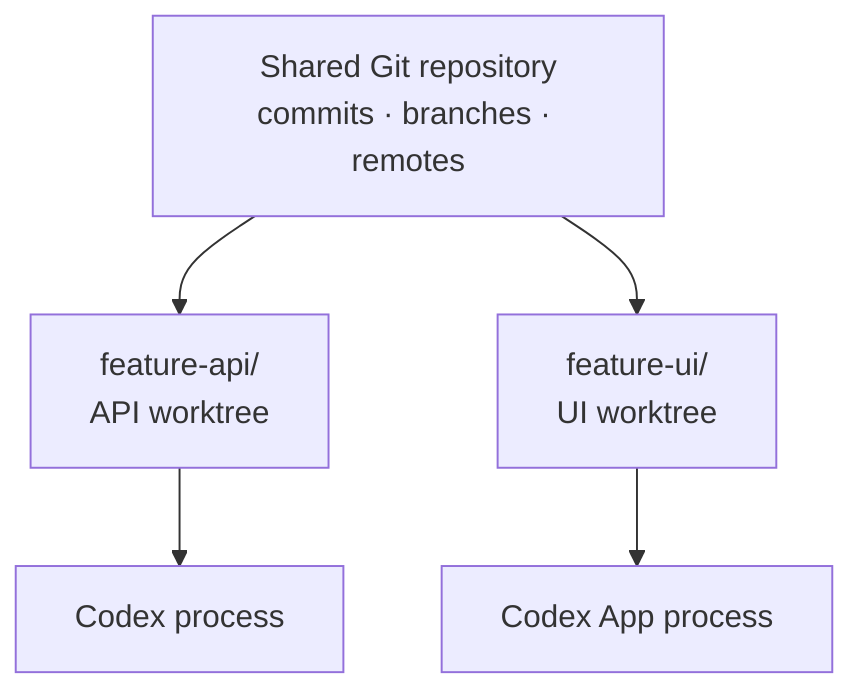

# Agent workflows

Wald gives every coding agent its own tree: a concrete Git worktree connected to the same repository.
Agents no longer share staged, unstaged, untracked, or generated files just because their tasks
belong to the same repository.



Commits remain visible through the shared repository. Files, `HEAD`, the index, dependencies, and
agent processes stay with their worktree. Ports, databases, containers, and external services are
not automatically isolated; coordinate them separately.

The examples use the recommended flat [Wald Flow layout](worktrees.md#wald-flow), but the same agent
isolation works in grouped and retained-checkout workspaces.

## Run two tasks in parallel

**Starting point:** an API task and a UI task must progress independently.

```sh
wald create feature/api
wald create feature/ui
wald list
```

```text
project/
├── feature-api/             Codex edits and commits feature/api here
└── feature-ui/              Codex App edits and commits feature/ui here
```

Built-in profiles cover Code, Cursor, Zed, Codex, Codex App, and Claude. Effective project
configuration can define or replace profiles under `tools`; custom definitions override same-named
built-ins, and workspace-local definitions override same-named repository profiles.

Open foreground agents from separate terminals:

```sh
# Terminal A
wald open feature-api --tool codex

# Terminal B
wald open feature-ui --tool codex-app
```

Each agent remains responsible for its own edits and commits. If the project exposes a `verify`
task, verify and remove the completed worktrees separately:

```sh
wald run verify feature-api
wald remove feature-api

wald run verify feature-ui
wald remove feature-ui
```

Removal preserves each branch by default. Interactive users may select eligible local branches for
deletion; an unmerged branch additionally requires `--force`. Automation must request deletion
explicitly with `--delete-branch --yes` and must not add `--force` without permission to discard the
unmerged work. If another person or agent still needs a worktree or branch, do not remove it without
an explicit handoff.

## Hand off unfinished code

When unfinished local code should continue on a fresh branch, run the handoff from its current
worktree:

```sh
wald handoff feature/review --tool codex
```

Wald creates the branch at the current `HEAD`, reproduces staged, unstaged, and non-ignored untracked
state in the new worktree, verifies both sides, and keeps the source unchanged. `wald create
feature/review --carry` uses the same lifecycle. This transfers code only: start the new editor or
agent separately, and explicitly pass it any task context. Running processes and agent sessions do
not move between worktrees.

## Operating rules for agents

- Start with `wald doctor --json` when runtime or workspace consistency is uncertain.
- Use `wald status --json` to understand the current context and local tracking state.
- Use `wald list --json` for complete worktree records; do not guess paths from branch names.
- For mutations, use the command's `--json` contract with explicit branches, worktrees, and `--yes`
  where required. JSON mode performs the mutation; it is not a dry run or additional consent.
- Resolve a path with `wald cd <worktree>`.
- Prefer direct commands in non-interactive sessions.
- Run shared project actions through `wald run` so configured order, environment, timeouts, and trust
  checks remain consistent.
- Use either `--tool` to open an agent or `--cd` to enter the worktree during creation; they cannot
  be combined.
- Use `wald handoff <new-branch>` only when duplicating the current local code is intended; after
  success, the changes exist in both worktrees.
- Inspect dirty, unmerged, and locked state before any forced removal.

Wald deliberately does not orchestrate multiple agents or transfer running sessions. Its handoff is
limited to a verified copy of local code into a fresh worktree.

See [Wald Flow](worktrees.md#wald-flow) for the recommended workspace layout,
[four everyday workflows](worktrees.md#four-everyday-workflows) for the general worktree model, and
[Configuration](configuration.md#named-tasks-and-tool-profiles) for custom tools and tasks.

## Portable Agent Skill

[`skills/wald-worktrees`](../skills/wald-worktrees/SKILL.md) teaches compatible agents how to discover
and use the CLI safely. Copy that directory into the skill location supported by the agent host, or
include it with the repository so the host can discover it.

The skill routes detailed creation and lifecycle questions to focused references, keeping its
default context small.
