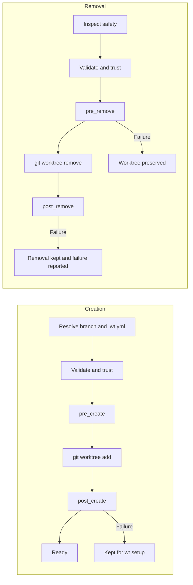

# Configuration

`wt` has one local configuration and one optional project configuration. Both are strict,
versioned YAML documents; unknown fields are errors.

## Local workspace configuration

Dedicated workspaces store `.wt/workspace.yml`. Adopted repositories store
`<git-common-dir>/wt/workspace.yml` and expose it through a `.wt` link in the worktree container.
This file is local and should not be committed.

```yaml
version: 1
mode: managed
paths:
  git: ../repo.git
  worktrees: ..
  primary_worktree: null
remote:
  name: origin
  fetch_refspec: +refs/heads/*:refs/remotes/origin/*
default_branch: main
trusted_project_config: null
```

All stored paths are relative to the configuration. `wt` canonicalizes them and enforces the
managed/adopted layout boundaries before using them.

## Project configuration

Generate a starting point interactively:

```sh
wt config init [worktree]
```

The wizard detects a package manager, package scripts, and files such as `.env.example`. It can add
an install hook, an environment copy step, a `verify` task, and a default tool. For scripts, use
`wt config init --yes`; use `--force` separately when an existing file may be replaced. Interactive
`wt init` offers the same wizard immediately after adopting a working repository.

The repository-owned `.wt.yml` supports this top-level schema:

```yaml
version: 1
defaults:
  fetch: true
  tool: code
hooks:
  pre_create: []
  post_create: []
  pre_remove: []
  post_remove: []
tasks: {}
tools: {}
```

Every section except `version` is optional and receives the defaults above.

### Complete example

This example demonstrates every lifecycle hook, safe argument-array commands, copy/symlink setup,
named tasks, and a custom agent profile. Adapt its project-specific paths before using it:

```yaml
version: 1

defaults:
  fetch: true
  tool: codex

hooks:
  pre_create:
    - type: command
      argv: [node, -e, "process.exit(process.env.WT_BRANCH ? 0 : 1)"]
      cwd: workspace
      timeout_seconds: 30

  post_create:
    - type: command
      argv: [pnpm, install, --frozen-lockfile]
      cwd: target
      timeout_seconds: 600
    - type: copy
      source: default
      from: .env.example
      to: .env
      optional: true
    - type: symlink
      source: default
      from: .local/cache
      to: .local/cache
      optional: true

  pre_remove:
    - type: command
      argv: [node, scripts/check-worktree-removal.mjs]
      cwd: target

  post_remove:
    - type: command
      argv: [node, -e, "console.log(process.env.WT_BRANCH)"]
      cwd: workspace
      continue_on_error: true

tasks:
  verify:
    description: Run all checks before review
    steps:
      - type: command
        argv: [pnpm, run, lint]
      - type: command
        argv: [pnpm, run, typecheck]
      - type: command
        argv: [pnpm, run, test]
        timeout_seconds: 900

  dev:
    description: Start the local development process
    steps:
      - type: command
        argv: [pnpm, run, dev]

tools:
  review-agent:
    description: Start Codex with the repository review profile
    command: [codex, --profile, review]
    mode: foreground
```

### Command steps

Argument arrays are the default and do not invoke a shell:

```yaml
- type: command
  argv: [pnpm, install, --frozen-lockfile]
  cwd: target
  env:
    CI: "false"
  timeout_seconds: 600
  continue_on_error: false
```

Use `shell` only when shell syntax is intentional. It always executes as `/bin/sh -c` and cannot be
combined with `argv`:

```yaml
- type: command
  shell: pnpm build && cp dist/app "$WT_WORKTREE_PATH/.local/app"
```

`cwd` accepts `source`, `target`, or `workspace`. Its default is source for `pre_create`, workspace
for `post_remove`, and target otherwise. Commands receive:

During `pre_create`, the target worktree does not exist yet. On the first checkout of a managed
workspace there may also be no source worktree, so repository-local helper scripts should run in
`post_create` or use a source that is known to exist.

- `WT_EVENT`: hook name or `task:<name>`
- `WT_WORKSPACE_ROOT`
- `WT_SOURCE_PATH`
- `WT_WORKTREE_PATH`
- `WT_BRANCH`

### File steps

`copy` and `symlink` are available in `post_create` and named tasks:

```yaml
- type: copy
  source: default
  from: .env.example
  to: .env
  optional: true
  overwrite: false

- type: symlink
  source: primary
  from: .local/cache
  to: .local/cache
```

`source` is `current`, `default`, or `primary`. Paths must be relative and stay inside their source
and target worktrees after resolving symlinks. Copy rejects symlinks inside the copied tree;
generated symlinks use relative targets.

### Lifecycle

Creation runs in this order:

```text
resolve branch/config -> trust -> pre_create -> git worktree add -> post_create
```

Removal runs:

```text
safety inspection -> trust -> pre_remove -> git worktree remove -> post_remove
```



`pre_create` failure leaves no new worktree. `post_create` failure keeps the worktree and reports
`wt setup <worktree>` for recovery. A `pre_remove` failure preserves the worktree.

### Named tasks and tool profiles

```yaml
tasks:
  verify:
    description: Run checks used before review
    steps:
      - type: command
        argv: [pnpm, lint]
      - type: command
        argv: [pnpm, test]

tools:
  app-agent:
    description: Start an agent with the app profile
    command: [codex, --profile, app]
    mode: foreground
```

Run these with `wt run verify [worktree]` and `wt open [worktree] --tool app-agent`. Tool arguments
may contain `{path}`; the selected worktree is also the process working directory. `mode` is
`foreground` or `detached`.

Built-in profiles are `code`, `cursor`, `zed`, `codex`, `codex-app`, and `claude`; unavailable
commands are omitted from interactive selection.

## Trust

Any non-empty hook, task, or custom tool makes `.wt.yml` executable configuration. `wt` hashes the
validated, normalized behavior with SHA-256. This means comments, whitespace, and mapping order do
not change trust, while behavioral changes do.

```sh
wt config
wt config trust --yes
wt config untrust --yes
```

For a new managed workspace without a checkout, these commands inspect `.wt.yml` directly from the
configured default branch.
