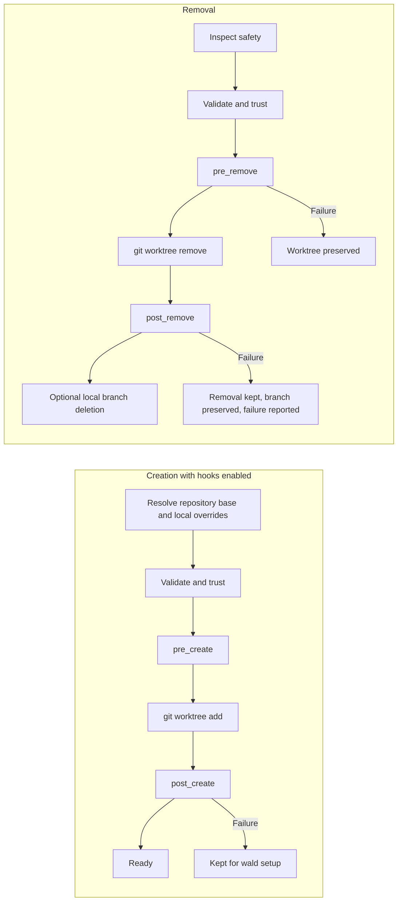

# Configuration

Every Wald workspace has one local configuration and one directory for shared local files. Project
setup may come from two configuration files. Every YAML document is strict and versioned; unknown
fields are errors.

Read [Worktrees explained](worktrees.md) first if the distinction between the shared repository and
per-worktree state is unfamiliar.

## Local workspace configuration

Dedicated workspaces store `.wald/workspace.yml`. Adopted repositories store
`<git-common-dir>/wald/workspace.yml` and expose it through a `.wald` link in the worktree container.
This file is local and should not be committed. The terms `managed` and `adopted` are internal
layout and safety states; the CLI describes them as a standalone workspace root or a retained
existing checkout.

```yaml
version: 1
mode: managed
paths:
  git: ../repo.git
  worktrees: ..
  primary_worktree: null
remote:
  name: origin
  fetch_refspec: +refs/heads/*:refs/remotes/origin/*
default_branch: main
trusted_project_config: null
```

All stored paths are relative to the configuration. `wald` canonicalizes them and enforces the
layout boundaries before using them.

### Workspace field reference

| Field | Type/default | Meaning and typical use |
| --- | --- | --- |
| `version` | `1` | Workspace schema version. |
| `mode` | `managed` or `adopted` | Internal safety mode. `managed` uses `repo.git`; `adopted` protects an existing primary checkout. |
| `paths.git` | relative path | Git common directory used for all worktree operations. Generated and validated by `wald`. |
| `paths.worktrees` | relative path | Parent directory in which `wald` creates worktrees. |
| `paths.primary_worktree` | relative path or `null` | Original checkout protected from `wald remove`; always `null` for a standalone bare workspace. |
| `remote` | object or `null` | Optional remote used for fetch and remote-branch resolution. `null` keeps the workspace local-only. |
| `remote.name` | string | Existing Git remote name such as `origin` or `upstream`. |
| `remote.fetch_refspec` | string | Explicit branch mapping used when `wald create` fetches. |
| `default_branch` | branch name | Default base, merge-check target, and preferred project-configuration branch. |
| `trusted_project_config` | SHA-256 or `null` | Semantic hash of the trusted effective project behavior. |

`default_branch` does three jobs:

1. New branches start from its remote-tracking or local ref when `--from` is omitted.
2. Safe removal checks whether a branch is merged into it.
3. `wald` uses its worktree/ref for repository project configuration and `source: default` when
   there is no better current source.

It does not switch existing branches, rename worktrees, or override an explicit `--from`.

### Supported layouts

The recommended flat standalone workspace is called
[Wald Flow](worktrees.md#wald-flow). It uses `paths.worktrees: ..`:

```text
project/
├── .wald/workspace.yml
├── .wald/project.yml         optional local automation and overrides
├── .wald/shared/
├── repo.git/
├── main/
└── feature-payment/
```

A grouped standalone workspace uses a child path such as `paths.worktrees: ../worktrees`:

```text
project/
├── .wald/workspace.yml
├── .wald/project.yml         optional local automation and overrides
├── .wald/shared/
├── repo.git/
└── worktrees/
    ├── main/
    └── feature-payment/
```

For standalone workspaces, `paths.worktrees` must resolve to the workspace root or one of its
descendants and must not overlap `.wald` or `repo.git`. Use `--worktrees-dir` during `wald init` rather
than editing generated paths manually.

When an existing checkout is retained, the worktree directory may be any safe directory outside
the Git directory and primary checkout. The physical configuration and shared files live below
`<git-common-dir>/wald`; the worktree container contains a `.wald` link to them. `wald config` prints the
canonical `workspace_config`, `workspace_root`, `worktrees_path`, and `shared_path` for both layouts.
Re-running `wald init` restores this link and its configured worktree container if either was deleted.

```text
parent/
├── project/                         existing primary checkout
│   └── .git/wald/
│       ├── workspace.yml
│       ├── project.yml      optional local automation and overrides
│       └── shared/
└── project-worktrees/
    └── .wald -> ../project/.git/wald
```

For a visual explanation of the shared and local pieces, see
[Shared and independent state](worktrees.md#shared-and-independent-state). A separate workspace
copied from a local repository starts with independent Git object files and does not use local clone
hardlinks.

### Local shared files

Every initialized workspace owns a `.wald/shared` directory. It is local, created with directory mode
`700`, and never committed. Project automation accesses it only through explicit trusted
`source: shared` steps. Files placed there retain their own permissions; use mode `600` for secrets.
Because these files can contain secrets or other local state, `wald uninit --apply` refuses to remove
them unless `--force` is also supplied.

## Project configuration

Wald combines up to two files into the configuration it actually uses:

1. `<worktree>/.wald.yml` is the repository-owned base and may vary by branch or revision.
2. `<workspace>/.wald/project.yml` is local to one Wald workspace and overrides that base for every
   worktree.

In an adopted workspace the local file physically lives at
`<git-common-dir>/wald/project.yml`. It is mode `600`, is never committed, and is protected as local
data during `wald uninit`. If only one source exists, it supplies the complete effective behavior.

Run the setup wizard to create a local configuration from detected Node package conventions:

```sh
wald config init [worktree]
```

To store project setup in the repository instead:

```sh
wald config init [worktree] --scope project
git diff -- .wald.yml
```

The wizard detects npm, pnpm, Yarn, or Bun, package scripts, and files such as `.env.example`. It can
add an install hook, an environment copy step, a `verify` task, a separate `dev` task for an exact
`dev` package script, and a default tool. The long-running `dev` script is never added to the
one-shot `verify` task. Interactive setup asks whether to create the `verify` task before offering
individual scripts; declining or selecting no scripts omits the task.

For workspace scope, the generator writes a sparse overlay: hooks and tasks that were not selected
are omitted, so existing repository behavior remains inherited. The explicit `--from-project` path
is the only generator mode that intentionally copies the complete repository configuration.

`Esc` returns to the preceding wizard step and restores the previous answer as its default;
`Ctrl-C` exits Wald. From the final preview, going back returns to the tool choice without discarding
the other detected setup decisions.

For scripts, use `wald config init --yes`; use `--force` separately when existing configuration at
the selected scope may be replaced. `--yes` keeps the detected recommended verify scripts.
Interactive `wald init` offers the same wizard after retaining a checkout or creating the default
worktree in a standalone workspace and recommends local storage. Automatic project detection
currently covers Node package managers; other ecosystems use manually configured commands.

During guided initialization, the wizard is a separate optional step after the workspace and, for
standalone layouts, the first worktree are ready. Cancelling it does not roll back the initialized
workspace.

When `.wald.yml` already exists, copy its complete normalized behavior into the local workspace with:

```sh
wald config init [worktree] --scope workspace --from-project --yes
```

The source `.wald.yml` remains in place and continues as the repository base until deliberately
removed. Copying it locally and then removing the source preserves the semantic behavior hash when
the effective configuration is unchanged. Wald never deletes, commits, or pushes `.wald.yml`.

The repository-owned `.wald.yml` supports this complete top-level schema:

```yaml
version: 1
defaults:
  fetch: true
  tool: code
hooks:
  pre_create: []
  post_create: []
  pre_remove: []
  post_remove: []
tasks: {}
tools: {}
```

Every section except `version` is optional and receives the defaults above.

The local `project.yml` uses the same fields as a partial overlay. Only fields present locally
override the repository base:

```yaml
version: 1
defaults:
  tool: null
hooks:
  post_create: []
tasks:
  inherited-task: null
  local-check:
    steps:
      - type: command
        argv: [pnpm, test]
tools:
  inherited-tool: null
```

| Local value | Merge behavior |
| --- | --- |
| `defaults.fetch` or `defaults.tool` | Override that field only; `tool: null` clears the inherited default. |
| `hooks.<event>` | Replace the complete inherited hook; `[]` disables it. |
| `tasks.<name>` | Add or replace that named task; `null` removes an inherited task. |
| `tools.<name>` | Add or replace that named tool; `null` removes an inherited tool. |

Wald executes and trusts the merged result, not either source file on its own.

| Field | Default | Purpose |
| --- | --- | --- |
| `version` | required `1` | Project schema version. |
| `defaults.fetch` | `true` | Fetch the configured remote before resolving branches. |
| `defaults.tool` | none | Editor or agent profile used by `wald open`/`wald create --open`. |
| `hooks.pre_create` | `[]` | Steps before `git worktree add`; no target checkout exists yet. |
| `hooks.post_create` | `[]` | Installation and local-file setup after checkout creation. |
| `hooks.pre_remove` | `[]` | Project checks that may stop removal before Git changes anything. |
| `hooks.post_remove` | `[]` | Cleanup after Git removed the worktree. |
| `tasks` | `{}` | Named workflows invoked with `wald run <task>`. |
| `tools` | `{}` | Project-specific editor or agent profiles. |

### Complete example

The example below includes every lifecycle hook, argument-array commands, copy and symlink setup,
named tasks, and a custom agent profile. Adjust its project-specific paths before using it:

```yaml
version: 1

defaults:
  fetch: true
  tool: codex

hooks:
  pre_create:
    - type: command
      argv: [node, -e, "process.exit(process.env.WALD_BRANCH ? 0 : 1)"]
      cwd: workspace
      timeout_seconds: 30

  post_create:
    - type: command
      argv: [pnpm, install, --frozen-lockfile]
      cwd: target
      timeout_seconds: 600
    - type: copy
      source: default
      from: config/local.example.json
      to: .local/config.json
      optional: true
    - type: symlink
      source: shared
      from: env
      glob: "**/.env*"
      to: .
      optional: true

  pre_remove:
    - type: command
      argv: [node, scripts/check-worktree-removal.mjs]
      cwd: target

  post_remove:
    - type: command
      argv: [node, -e, "console.log(process.env.WALD_BRANCH)"]
      cwd: workspace
      continue_on_error: true

tasks:
  verify:
    description: Run all checks before review
    steps:
      - type: command
        argv: [pnpm, run, lint]
      - type: command
        argv: [pnpm, run, typecheck]
      - type: command
        argv: [pnpm, run, test]
        timeout_seconds: 900

  dev:
    description: Start the local development process
    steps:
      - type: command
        argv: [pnpm, run, dev]

tools:
  review-agent:
    description: Start Codex with the repository review profile
    command: [codex, --profile, review]
    mode: foreground
```

### Command steps

Argument arrays are the default and do not invoke a shell:

```yaml
- type: command
  argv: [pnpm, install, --frozen-lockfile]
  cwd: target
  env:
    CI: "false"
  timeout_seconds: 600
  continue_on_error: false
```

Use `shell` only when shell syntax is intentional. It always executes as `/bin/sh -c` and cannot be
combined with `argv`:

```yaml
- type: command
  shell: pnpm build && cp dist/app "$WALD_WORKTREE_PATH/.local/app"
```

`cwd` accepts `source`, `target`, or `workspace`. Its default is source for `pre_create`, workspace
for `post_remove`, and target otherwise. Commands receive:

During `pre_create`, the target worktree does not exist yet. On the first checkout of a standalone
workspace there may also be no source worktree, so repository-local helper scripts should run in
`post_create` or use a source that is known to exist.

- `WALD_EVENT`: hook name or `task:<name>`
- `WALD_WORKSPACE_ROOT`
- `WALD_SOURCE_PATH`
- `WALD_WORKTREE_PATH`
- `WALD_BRANCH`

| Field | Default | Purpose |
| --- | --- | --- |
| `type` | required `command` | Selects command execution. |
| `argv` | none | Argument-safe executable and arguments; mutually exclusive with `shell`. |
| `shell` | none | Intentional `/bin/sh -c` expression; mutually exclusive with `argv`. |
| `cwd` | event-dependent | `source`, `target`, or `workspace`. |
| `env` | `{}` | Additional string environment variables. |
| `timeout_seconds` | none | Positive timeout, up to one day. |
| `continue_on_error` | `false` | Warn and continue with the next step after a failure. |

### File steps

`copy` and `symlink` are available in `post_create` and named tasks:

```yaml
- type: copy
  source: default
  from: .env.example
  to: .env
  optional: true
  on_existing: skip

- type: symlink
  source: primary
  from: .local/cache
  to: .local/cache

- type: symlink
  source: shared
  from: env
  glob: "**/.env*"
  to: .
```

| Source | Resolves to | Typical use |
| --- | --- | --- |
| `current` | Worktree from which the command was invoked | Carry a worktree-local file into another checkout. It may be unavailable from the workspace root. |
| `default` | Worktree on `default_branch` | Copy committed templates or stable local files from the main development checkout. |
| `primary` | Original protected checkout | Reuse local files after keeping an existing checkout. It is unavailable in standalone bare workspaces. |
| `shared` | Local `.wald/shared` directory | Central `.env`, credentials, caches, or editor configuration shared across worktrees. |

| Field | Default | Purpose |
| --- | --- | --- |
| `type` | required | `copy` creates an independent snapshot; `symlink` keeps one live central file. |
| `source` | `default` | Selects one of the roots above. |
| `from` | required | Relative file/directory, or the source directory used with `glob`. |
| `glob` | none | One positive relative pattern evaluated below `from`; matched file paths are preserved below `to`. |
| `to` | required | Exact target without `glob`; target directory with `glob`. |
| `optional` | `false` | Skip a missing exact source or a glob with no file matches. |
| `on_existing` | `error` | Handle a conflicting target with `error`, `skip`, or `replace`. |
| `overwrite` | none | Legacy alias: `false` means `error`, `true` means `replace`. Do not combine it with `on_existing`. |
| `continue_on_error` | `false` | Warn and continue after a failed file step. |

Source and target paths must be relative and remain inside their configured roots after resolving
symlinks. Copy rejects symlinks anywhere inside a copied tree. Generated symlinks use relative
targets, so a complete workspace remains relocatable.

Without `glob`, `from` and `to` retain their exact file-or-directory behavior. With `glob`, `from`
must be a directory and only matches that resolve to files are processed. The pattern cannot be
absolute, negated, or contain a `..` path segment. Directories are not independent matches.

All matches and destinations are sorted and validated before the first target is changed. A symlink
that already resolves to the intended real source is idempotent and reports `UNCHANGED`, even with
the default policy. Other existing files, directories, or different and broken symlinks follow
`on_existing`: `error` preserves the complete step and fails, `skip` preserves only conflicting
targets while processing the rest, and `replace` removes and recreates them. There is deliberately
no runtime `--force` for automation; replacement stays part of the reviewed and trusted behavior.

A glob `copy` rejects matched source symlinks. A glob `symlink` may resolve a source symlink only
when its target is a file inside the configured source root. `continue_on_error` applies to the
complete multi-file step. Legacy `overwrite` remains accepted, and equivalent legacy/new policies
produce the same semantic trust hash.

For centrally edited monorepo environment files, preserve their repository-relative structure:

```yaml
hooks:
  post_create:
    - type: symlink
      source: shared
      from: env
      glob: "**/.env*"
      to: .
```

The source-relative portion below `env` becomes the target-relative path, producing `.env`,
`apps/api/.env`, and `apps/web/.env.local`. Editing a shared source updates every symlink
immediately. A copied target changes only after the corresponding named task or `wald setup` runs
again; `wald hook run post_create` is the equivalent general hook command. Because file steps can
expose local data, their exact paths and glob patterns participate in the same project-configuration
trust hash as commands.

Every non-empty automation run reports its selected worktree, branch, target path, and step results.
In a terminal, Wald groups each configured step and nests concrete file operations beneath it:

```text
┌  Hook post_create
│  Worktree  feature-payment
│  Branch    feature/payment
│  Path      /workspace/feature-payment
│
◇  1 command  pnpm install --frozen-lockfile
│  command output remains visible here
◆  DONE · 1.4s
│
◇  2 symlink  shared:env/**/*.env* → target:.
├  UNCHANGED  shared:env/.env → target:.env · already linked
├  CREATED    shared:env/apps/api/.env → target:apps/api/.env
└  1 created · 1 unchanged
│
└  2 steps · 1 created · 1 unchanged · 1 done
```

Each lifecycle hook receives its own labeled block; consecutive hooks are separated by a blank
line. Named tasks use the same layout with a `Task` heading. Each configured step number appears
once, and sorted glob results remain together beneath their shared source pattern. File steps end
with an outcome count when they produce multiple results.

Command argument arrays retain visible argument boundaries; shell expressions show the actual
`/bin/sh -c` invocation. A working directory is shown only when it differs from the selected
worktree. While a configured step runs, its title shows an animated spinner. Command steps keep the
latest ten output lines in view beneath that spinner; after the step finishes, its title, result,
and complete output remain in the scrollback. Cursor and erase sequences may be normalized so
progress-oriented child output does not corrupt the surrounding layout. Environment values are
never printed or expanded.

Redirected and other non-TTY output keeps the append-only row format. It prints `RUNNING` before
each configured step, streams command output without presentation changes, and then prints the
result. The same rows work in logs and scripts:

```text
STEP  STATUS     TYPE      SOURCE / COMMAND                    TARGET / CWD                  NOTE
1     RUNNING    command   pnpm install --frozen-lockfile      /workspace/feature-payment
1     DONE       command   pnpm install --frozen-lockfile      /workspace/feature-payment
2     RUNNING    symlink   shared:env/.env                     target:.env
2     UNCHANGED  symlink   shared:env/.env                     target:.env                   already linked
```

File operations report `CREATED`, `UNCHANGED`, `SKIPPED`, `REPLACED`, or `FAILED` after their
`RUNNING` row, with scoped source and target paths. Glob results remain sorted. Optional missing
sources and empty globs use `SKIPPED` with `source not found`, `source unavailable`, or
`no files matched` in the note. A target conflict under the default policy uses `FAILED` and points
to `on_existing: skip|replace`; `continue_on_error` adds `continuing` before the next step begins.

Non-optional missing sources and empty globs remain errors. A continued failure is included in the
terminal summary before the next step runs. Statuses, worktree and branch names, and paths are
colored in a terminal while redirected output remains readable plain text.

### Lifecycle

By default, creation runs in this order:

```text
resolve branch/config -> trust -> pre_create -> git worktree add -> post_create
```

`create`, its alias `plant`, and `handoff` accept `--skip-hooks` to skip both create events,
including command, copy, and symlink steps. The guided create and handoff flows offer the same
choice when hooks are configured. Skipping needs no creation-time trust approval and does not
change saved trust; configuration validation and carry checks remain active. Opening a tool still
requires its usual trust check. This choice is per invocation: `wald setup <worktree>` can run
`post_create` later after trust approval. See the [create reference](cli-reference.md#wald-create)
for flags and navigation.

Removal runs:

```text
safety inspection -> trust -> pre_remove -> git worktree remove -> post_remove -> optional local branch deletion
```



`pre_create` failure leaves no new worktree. `post_create` failure keeps the worktree and reports
`wald setup <worktree>` for recovery. A `pre_remove` failure preserves the worktree.
Branch deletion happens only after a successful `post_remove`; a changed or newly checked-out
branch is preserved and reported instead.

### Run hooks manually

After changing `.wald/project.yml` or `.wald.yml`, inspect and trust the effective behavior from the
target worktree, then run the hook explicitly:

```sh
cd feature-payment
wald config
wald config trust --yes
wald hook run post_create
```

`wald hook run <event> [worktree]` accepts all four lifecycle events and reloads both configuration
sources for every invocation. If the edit changes executable behavior, the semantic hash changes
and Wald requires a new trust decision. Formatting-only changes keep existing trust valid.

Manual execution never performs `git worktree add` or `git worktree remove`. It uses the selected
existing worktree as `WALD_WORKTREE_PATH`; the normal working-directory defaults still apply:
`pre_create` uses the preferred source, `post_remove` uses the workspace, and the other events use
the target. Because `pre_create` normally runs before the target exists and `post_remove` normally
runs after it is gone, Wald warns that manual runs of these two events simulate a different lifecycle
state. `wald setup [worktree]` remains a compatibility shortcut for manually running `post_create`.

### Named tasks and tool profiles

```yaml
tasks:
  verify:
    description: Run checks used before review
    steps:
      - type: command
        argv: [pnpm, lint]
      - type: command
        argv: [pnpm, test]

tools:
  app-agent:
    description: Start an agent with the app profile
    command: [codex, --profile, app]
    mode: foreground
```

Run these with `wald run verify [worktree]` and `wald open [worktree] --tool app-agent`. Tool arguments
may contain `{path}`; the selected worktree is also the process working directory. `mode` is
`foreground` or `detached`.

Effective custom tools override built-in profiles with the same name. This lets a trusted project
redefine `code`, `codex`, or another built-in deliberately. `{path}` is expanded before executable
availability is checked, and relative executable paths resolve from the selected worktree.

| Field | Default | Purpose |
| --- | --- | --- |
| `tasks.<name>.description` | none | Human-readable text shown during interactive task selection. |
| `tasks.<name>.steps` | required, non-empty | Ordered command/copy/symlink steps executed by `wald run`. |
| `tools.<name>.description` | none | Human-readable editor or agent description. |
| `tools.<name>.command` | required, non-empty | Argument array used to start the tool; `{path}` expands to the selected worktree. |
| `tools.<name>.mode` | `foreground` | `foreground` waits and returns its exit status; `detached` starts independently. |

Long-running tasks such as `wald run dev` stream their output in the foreground. `Ctrl-C` stops the
child process and exits with status 130 without reporting the interruption as a configuration
failure.

Built-in profiles are `code`, `cursor`, `zed`, `codex`, `codex-app`, and `claude`; unavailable
commands are omitted from interactive selection.

Repository-owned `.wald.yml` must be a regular file. Wald rejects a symbolic link or directory at
that path so executable configuration cannot silently resolve outside the worktree.

## Trust

Any non-empty effective hook, task, or custom tool makes project configuration executable. Wald
hashes the merged, validated, normalized behavior with SHA-256. Comments, whitespace, mapping order,
and moving identical behavior between `.wald.yml` and `.wald/project.yml` do not change trust;
behavioral changes in either source do.

```sh
wald config
wald config trust --yes
wald config untrust --yes
```

For a standalone workspace without a checkout, these commands combine local `project.yml` with
`.wald.yml` read directly from the configured default branch or revision.
