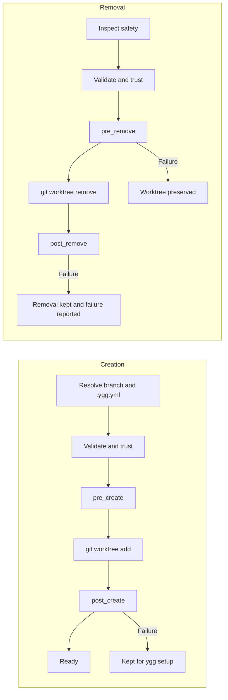

# Configuration

`ygg` has one local configuration, one local shared-file area, and one optional project
configuration. Both YAML documents are strict and versioned; unknown fields are errors.

## Local workspace configuration

Dedicated workspaces store `.ygg/workspace.yml`. Adopted repositories store
`<git-common-dir>/ygg/workspace.yml` and expose it through a `.ygg` link in the worktree container.
This file is local and should not be committed. The terms `managed` and `adopted` are internal
layout and safety states; the CLI describes them as a standalone workspace root or a retained
existing checkout.

```yaml
version: 1
mode: managed
paths:
  git: ../repo.git
  worktrees: ..
  primary_worktree: null
remote:
  name: origin
  fetch_refspec: +refs/heads/*:refs/remotes/origin/*
default_branch: main
trusted_project_config: null
```

All stored paths are relative to the configuration. `ygg` canonicalizes them and enforces the
layout boundaries before using them.

### Workspace field reference

| Field | Type/default | Meaning and typical use |
| --- | --- | --- |
| `version` | `1` | Workspace schema version. |
| `mode` | `managed` or `adopted` | Internal safety mode. `managed` uses `repo.git`; `adopted` protects an existing primary checkout. |
| `paths.git` | relative path | Git common directory used for all worktree operations. Generated and validated by `ygg`. |
| `paths.worktrees` | relative path | Parent directory in which `ygg` creates worktrees. |
| `paths.primary_worktree` | relative path or `null` | Original checkout protected from `ygg remove`; always `null` for a standalone bare workspace. |
| `remote` | object or `null` | Optional remote used for fetch and remote-branch resolution. `null` keeps the workspace local-only. |
| `remote.name` | string | Existing Git remote name such as `origin` or `upstream`. |
| `remote.fetch_refspec` | string | Explicit branch mapping used when `ygg create` fetches. |
| `default_branch` | branch name | Default base, merge-check target, and preferred project-configuration branch. |
| `trusted_project_config` | SHA-256 or `null` | Semantic hash of the locally trusted executable `.ygg.yml` behavior. |

`default_branch` does three jobs:

1. New branches start from its remote-tracking or local ref when `--from` is omitted.
2. Safe removal checks whether a branch is merged into it.
3. `ygg` uses its worktree/ref for `.ygg.yml` and `source: default` when there is no better current
   source.

It does not switch existing branches, rename worktrees, or override an explicit `--from`.

### Supported layouts

The recommended flat standalone workspace uses `paths.worktrees: ..`:

```text
project/
├── .ygg/workspace.yml
├── .ygg/shared/
├── repo.git/
├── main/
└── feature-payment/
```

A grouped standalone workspace uses a child path such as `paths.worktrees: ../worktrees`:

```text
project/
├── .ygg/workspace.yml
├── .ygg/shared/
├── repo.git/
└── worktrees/
    ├── main/
    └── feature-payment/
```

For standalone workspaces, `paths.worktrees` must resolve to the workspace root or one of its
descendants and must not overlap `.ygg` or `repo.git`. Use `--worktrees-dir` during `ygg init` rather
than editing generated paths manually.

When an existing checkout is retained, the worktree directory may be any safe directory outside
the Git directory and primary checkout. The physical configuration and shared files live below
`<git-common-dir>/ygg`; the worktree container contains a `.ygg` link to them. `ygg config` prints the
canonical `workspace_config`, `workspace_root`, `worktrees_path`, and `shared_path` for both layouts.

### Local shared files

Every initialized workspace owns a `.ygg/shared` directory. It is local, created with directory mode
`700`, and never committed. Project automation accesses it only through explicit trusted
`source: shared` steps. Files placed there retain their own permissions; use mode `600` for secrets.

## Project configuration

Generate a starting point interactively from detected Node package conventions:

```sh
ygg config init [worktree]
```

The wizard detects npm, pnpm, Yarn, or Bun, package scripts, and files such as `.env.example`. It can
add an install hook, an environment copy step, a `verify` task, a separate `dev` task for an exact
`dev` package script, and a default tool. The long-running `dev` script is never added to the
one-shot `verify` task.

For scripts, use `ygg config init --yes`; use `--force` separately when an existing file may be
replaced. Interactive `ygg init` offers the same wizard after retaining a checkout or creating the
default worktree in a standalone workspace. Automatic project detection currently covers Node
package managers; other ecosystems use manually configured commands.

`.ygg.yml` is repository-owned behavior. Review and commit it on the branch used as the base for
future worktrees before expecting those worktrees to use it:

```sh
ygg config init
git diff -- .ygg.yml
git add .ygg.yml
git commit -m "chore: configure worktree setup"
ygg config trust
```

`ygg` never commits or pushes this file automatically. Trust is semantic, so committing the reviewed
file without changing its behavior does not invalidate an already recorded hash.

The repository-owned `.ygg.yml` supports this top-level schema:

```yaml
version: 1
defaults:
  fetch: true
  tool: code
hooks:
  pre_create: []
  post_create: []
  pre_remove: []
  post_remove: []
tasks: {}
tools: {}
```

Every section except `version` is optional and receives the defaults above.

| Field | Default | Purpose |
| --- | --- | --- |
| `version` | required `1` | Project schema version. |
| `defaults.fetch` | `true` | Fetch the configured remote before resolving branches. |
| `defaults.tool` | none | Editor or agent profile used by `ygg open`/`ygg create --open`. |
| `hooks.pre_create` | `[]` | Steps before `git worktree add`; no target checkout exists yet. |
| `hooks.post_create` | `[]` | Installation and local-file setup after checkout creation. |
| `hooks.pre_remove` | `[]` | Project checks that may stop removal before Git changes anything. |
| `hooks.post_remove` | `[]` | Cleanup after Git removed the worktree. |
| `tasks` | `{}` | Named workflows invoked with `ygg run <task>`. |
| `tools` | `{}` | Project-specific editor or agent profiles. |

### Complete example

This example demonstrates every lifecycle hook, safe argument-array commands, copy/symlink setup,
named tasks, and a custom agent profile. Adapt its project-specific paths before using it:

```yaml
version: 1

defaults:
  fetch: true
  tool: codex

hooks:
  pre_create:
    - type: command
      argv: [node, -e, "process.exit(process.env.YGG_BRANCH ? 0 : 1)"]
      cwd: workspace
      timeout_seconds: 30

  post_create:
    - type: command
      argv: [pnpm, install, --frozen-lockfile]
      cwd: target
      timeout_seconds: 600
    - type: copy
      source: default
      from: config/local.example.json
      to: .local/config.json
      optional: true
    - type: symlink
      source: shared
      from: env
      glob: "**/.env*"
      to: .
      optional: true

  pre_remove:
    - type: command
      argv: [node, scripts/check-worktree-removal.mjs]
      cwd: target

  post_remove:
    - type: command
      argv: [node, -e, "console.log(process.env.YGG_BRANCH)"]
      cwd: workspace
      continue_on_error: true

tasks:
  verify:
    description: Run all checks before review
    steps:
      - type: command
        argv: [pnpm, run, lint]
      - type: command
        argv: [pnpm, run, typecheck]
      - type: command
        argv: [pnpm, run, test]
        timeout_seconds: 900

  dev:
    description: Start the local development process
    steps:
      - type: command
        argv: [pnpm, run, dev]

tools:
  review-agent:
    description: Start Codex with the repository review profile
    command: [codex, --profile, review]
    mode: foreground
```

### Command steps

Argument arrays are the default and do not invoke a shell:

```yaml
- type: command
  argv: [pnpm, install, --frozen-lockfile]
  cwd: target
  env:
    CI: "false"
  timeout_seconds: 600
  continue_on_error: false
```

Use `shell` only when shell syntax is intentional. It always executes as `/bin/sh -c` and cannot be
combined with `argv`:

```yaml
- type: command
  shell: pnpm build && cp dist/app "$YGG_WORKTREE_PATH/.local/app"
```

`cwd` accepts `source`, `target`, or `workspace`. Its default is source for `pre_create`, workspace
for `post_remove`, and target otherwise. Commands receive:

During `pre_create`, the target worktree does not exist yet. On the first checkout of a standalone
workspace there may also be no source worktree, so repository-local helper scripts should run in
`post_create` or use a source that is known to exist.

- `YGG_EVENT`: hook name or `task:<name>`
- `YGG_WORKSPACE_ROOT`
- `YGG_SOURCE_PATH`
- `YGG_WORKTREE_PATH`
- `YGG_BRANCH`

| Field | Default | Purpose |
| --- | --- | --- |
| `type` | required `command` | Selects command execution. |
| `argv` | none | Argument-safe executable and arguments; mutually exclusive with `shell`. |
| `shell` | none | Intentional `/bin/sh -c` expression; mutually exclusive with `argv`. |
| `cwd` | event-dependent | `source`, `target`, or `workspace`. |
| `env` | `{}` | Additional string environment variables. |
| `timeout_seconds` | none | Positive timeout, up to one day. |
| `continue_on_error` | `false` | Warn and continue with the next step after a failure. |

### File steps

`copy` and `symlink` are available in `post_create` and named tasks:

```yaml
- type: copy
  source: default
  from: .env.example
  to: .env
  optional: true
  overwrite: false

- type: symlink
  source: primary
  from: .local/cache
  to: .local/cache

- type: symlink
  source: shared
  from: env
  glob: "**/.env*"
  to: .
```

| Source | Resolves to | Typical use |
| --- | --- | --- |
| `current` | Worktree from which the command was invoked | Carry a worktree-local file into another checkout. It may be unavailable from the workspace root. |
| `default` | Worktree on `default_branch` | Copy committed templates or stable local files from the main development checkout. |
| `primary` | Original protected checkout | Reuse local files after keeping an existing checkout. It is unavailable in standalone bare workspaces. |
| `shared` | Local `.ygg/shared` directory | Central `.env`, credentials, caches, or editor configuration shared across worktrees. |

| Field | Default | Purpose |
| --- | --- | --- |
| `type` | required | `copy` creates an independent snapshot; `symlink` keeps one live central file. |
| `source` | `default` | Selects one of the roots above. |
| `from` | required | Relative file/directory, or the source directory used with `glob`. |
| `glob` | none | One positive relative pattern evaluated below `from`; matched file paths are preserved below `to`. |
| `to` | required | Exact target without `glob`; target directory with `glob`. |
| `optional` | `false` | Skip a missing exact source or a glob with no file matches. |
| `overwrite` | `false` | Replace an existing target only when explicitly enabled. |
| `continue_on_error` | `false` | Warn and continue after a failed file step. |

Source and target paths must be relative and remain inside their configured roots after resolving
symlinks. Copy rejects symlinks anywhere inside a copied tree. Generated symlinks use relative
targets, so a complete workspace remains relocatable.

Without `glob`, `from` and `to` retain their exact file-or-directory behavior. With `glob`, `from`
must be a directory and only matches that resolve to files are processed. The pattern cannot be
absolute, negated, or contain a `..` path segment. Directories are not independent matches.

All matches and destinations are sorted and validated before the first target is changed. Existing
targets therefore fail the complete step unless `overwrite: true` is set. A glob `copy` rejects
matched source symlinks; a glob `symlink` may resolve a source symlink only when its target is a file
inside the configured source root. `continue_on_error` applies to the complete multi-file step.

For centrally edited monorepo environment files, preserve their repository-relative structure:

```yaml
hooks:
  post_create:
    - type: symlink
      source: shared
      from: env
      glob: "**/.env*"
      to: .
```

The source-relative portion below `env` becomes the target-relative path, producing `.env`,
`apps/api/.env`, and `apps/web/.env.local`. Editing a shared source updates every symlink
immediately. A copied target changes only after the corresponding named task or `ygg setup` runs
again. Because file steps can expose local data, their exact paths and glob patterns participate in
the same project-configuration trust hash as commands.

### Lifecycle

Creation runs in this order:

```text
resolve branch/config -> trust -> pre_create -> git worktree add -> post_create
```

Removal runs:

```text
safety inspection -> trust -> pre_remove -> git worktree remove -> post_remove
```



`pre_create` failure leaves no new worktree. `post_create` failure keeps the worktree and reports
`ygg setup <worktree>` for recovery. A `pre_remove` failure preserves the worktree.

### Named tasks and tool profiles

```yaml
tasks:
  verify:
    description: Run checks used before review
    steps:
      - type: command
        argv: [pnpm, lint]
      - type: command
        argv: [pnpm, test]

tools:
  app-agent:
    description: Start an agent with the app profile
    command: [codex, --profile, app]
    mode: foreground
```

Run these with `ygg run verify [worktree]` and `ygg open [worktree] --tool app-agent`. Tool arguments
may contain `{path}`; the selected worktree is also the process working directory. `mode` is
`foreground` or `detached`.

| Field | Default | Purpose |
| --- | --- | --- |
| `tasks.<name>.description` | none | Human-readable text shown during interactive task selection. |
| `tasks.<name>.steps` | required, non-empty | Ordered command/copy/symlink steps executed by `ygg run`. |
| `tools.<name>.description` | none | Human-readable editor or agent description. |
| `tools.<name>.command` | required, non-empty | Argument array used to start the tool; `{path}` expands to the selected worktree. |
| `tools.<name>.mode` | `foreground` | `foreground` waits and returns its exit status; `detached` starts independently. |

Long-running tasks such as `ygg run dev` stream their output in the foreground. `Ctrl-C` stops the
child process and exits with status 130 without reporting the interruption as a configuration
failure.

Built-in profiles are `code`, `cursor`, `zed`, `codex`, `codex-app`, and `claude`; unavailable
commands are omitted from interactive selection.

## Trust

Any non-empty hook, task, or custom tool makes `.ygg.yml` executable configuration. `ygg` hashes the
validated, normalized behavior with SHA-256. This means comments, whitespace, and mapping order do
not change trust, while behavioral changes do.

```sh
ygg config
ygg config trust --yes
ygg config untrust --yes
```

For a new standalone workspace without a checkout, these commands inspect `.ygg.yml` directly from the
configured default branch.
