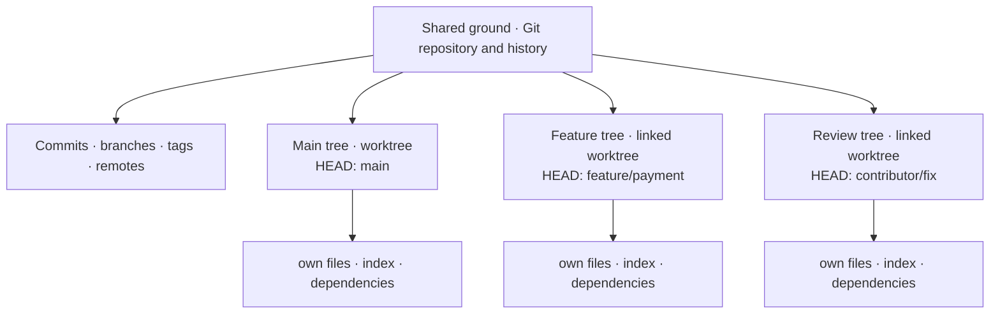
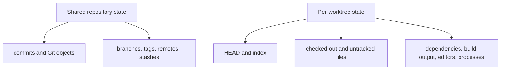
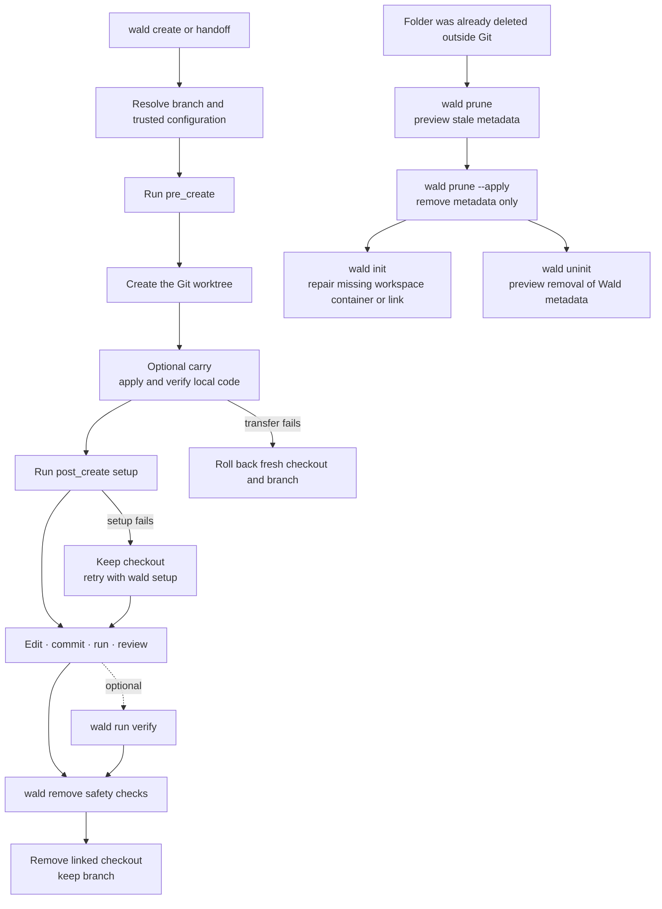

# Worktrees explained

Git worktrees let one repository have several working folders at the same time. You can leave a
half-finished feature open in one folder and fix a production bug in another. This guide explains
what Git shares between those folders, what stays separate, and where Wald helps.

## The forest as a mental model

Wald borrows the forest picture to explain how the pieces fit together. Git, the CLI, and the
configuration still use their proper technical names:

| Forest image | Technical meaning |
| --- | --- |
| Forest | The complete Wald workspace. |
| Shared ground and root network | Git's common directory (`repo.git` in a standalone workspace), which keeps shared objects, refs, remotes, and worktree metadata. |
| Tree | An independent worktree folder with its own files, `HEAD`, index, and processes. |
| New growth | A feature, hotfix, review, experiment, or agent task created in its own worktree. |

The default branch is the preferred base for new work and the comparison target for safe removal;
Wald does not enforce one history. An explicit `--from` may start new work from another commit.

## The four building blocks

Most worktree confusion disappears once these four terms are kept separate:

| Term | Think of it as | Example |
| --- | --- | --- |
| Repository | The shared Git database and history | Commits, branches, tags, and remotes |
| Branch | A movable name for a line of commits | `main`, `feature/payment` |
| Checkout | Files from one commit written into a folder | The files currently visible in an editor |
| Worktree | One checkout plus its own Git working state | `feature-payment/` with its own `HEAD` and index |

A normal clone combines one repository and one main worktree. Linked worktrees add more checkout
folders without cloning the complete repository again.



In a Wald standalone workspace, the same relationship is visible on disk:

```text
project/
├── .wald/                    Wald workspace metadata and shared local files
├── repo.git/                shared Git objects, refs, remotes, and worktree metadata
├── main/                    files + HEAD + index for main
├── feature-payment/         files + HEAD + index for feature/payment
└── contributor-fix/         files + HEAD + index for contributor/fix
```

You work in each folder as usual: open it in an editor, run `git status`, edit files, commit, and
start processes. A commit created in one worktree immediately becomes part of the shared repository
and is visible from the others.

## Shared and independent state

Files and staging are separate; commits and refs are not. In practice, that means:



| Action | Effect |
| --- | --- |
| Edit a file | Changes only that worktree's folder. |
| Stage a file | Changes only that worktree's index. |
| Create a commit | Adds the commit to the shared repository. |
| Fetch a remote | Updates shared remote-tracking refs for all worktrees. |
| Install dependencies | Writes into that worktree unless the package manager uses an external cache. |
| Start a server | Starts a separate process, but ports and external services may still conflict. |

## Four everyday workflows

### 1. Fix production without disturbing a feature

You are halfway through `feature/payment` when production needs a fix based on `release/1.x`. Leave
the feature folder alone and create the hotfix beside it:

```sh
wald create hotfix/payment --from release/1.x --tool code
```

```text
project/
├── feature-payment/         unfinished files remain exactly as they are
└── hotfix-payment/          clean checkout based on release/1.x
```

Commit and publish the hotfix normally. After it is merged:

```sh
wald remove hotfix-payment
```

The hotfix folder is removed after safety checks. The branch and the feature worktree remain.

### 2. Review a teammate's branch beside your own work

Your current branch needs to stay open, but `contributor/payment-fix` is ready for review on the
configured remote. Create a second folder and run the project's `verify` task there:

```sh
wald create contributor/payment-fix --tool code
wald run verify contributor-payment-fix
```

```text
project/
├── feature-payment/             your current work
└── contributor-payment-fix/     review checkout tracking the remote branch
```

When the review is complete:

```sh
wald remove contributor-payment-fix
```

Wald fetches according to project configuration and prefers an existing local branch, then a matching
remote branch, before creating a new branch. A matching remote branch is tracked. A newly created
local branch has no upstream even when its history starts at the configured remote default branch;
Wald prints the explicit `git push -u <remote> HEAD` command needed to publish it.

### 3. Keep coding while a long test runs

A migration test will run for a while, and you still want to use the main folder for development.
Give the test its own worktree:

```sh
wald create experiment/migration
wald exec experiment-migration -- pnpm test
```

```text
project/
├── main/                    editor and development server stay available
└── experiment-migration/    test process and generated output stay here
```

Continue in `main/` from another terminal. Inspect and remove the experiment when it is no longer
needed:

```sh
wald remove experiment-migration
```

### 4. Give parallel agents separate files

Two coding agents need the same repository, but they must not share staged, unstaged, untracked, or
generated files. Give each task its own branch and folder:

```sh
wald create feature/api
wald create feature/ui
wald list
```

```text
project/
├── feature-api/             API agent, commits on feature/api
└── feature-ui/              UI agent, commits on feature/ui
```

Open the agents from separate terminals so foreground tools can run at the same time:

```sh
# Terminal A
wald open feature-api --tool codex

# Terminal B
wald open feature-ui --tool codex-app
```

Each agent owns a real checkout. When the project exposes a `verify` task, verify and remove each
task independently:

```sh
wald run verify feature-api
wald remove feature-api
wald run verify feature-ui
wald remove feature-ui
```

Wald separates filesystem state; it does not coordinate agent decisions, running sessions, ports,
databases, or other shared services.

## Carry unfinished code into another worktree

Sometimes the code in front of you belongs on a fresh branch, but cleaning the current folder first
would only get in the way. Carry the staged, unstaged, and untracked state into a new worktree:

```sh
wald create feature/review --carry
# equivalent code-focused workflow
wald handoff feature/review
```

```text
project/
├── feature-payment/         original local state remains here
└── feature-review/          same local state, new branch at the original HEAD
```

Carry preserves which tracked changes are staged and which remain unstaged. It also copies
non-ignored untracked regular files and symlinks, including binary content and executable modes.
Ignored files remain local and can instead be supplied through trusted copy or symlink
configuration. Empty directories and submodules are not transferred.

Both commands use the current effective project configuration and the normal trusted lifecycle. A
transfer failure before `post_create` rolls back the fresh worktree and branch when safe; a
`post_create` failure keeps the verified target for `wald setup`. After success, the changes exist in
both worktrees. `handoff` does not move an editor, process, or agent session.

When the branch was chosen interactively, Wald shows the complete create plan and confirms it before
trust, hooks, branch creation, or checkout creation. Explicit branch commands remain prompt-free.

## The worktree lifecycle

Creation and removal follow the same path in every supported workspace layout. **Wald Flow** is the
name of the recommended flat layout, not a branching model or this create-to-remove sequence.



`remove` is the normal finish path. `prune` is not a faster removal command; it repairs stale Git
administrative state after a registered directory is already missing. Locked registrations are
preserved. `init` repairs the workspace infrastructure after stale registrations are gone;
`uninit` is the explicit path for disconnecting the repository from Wald. A normal removal retires
one worktree while its branch and shared Git history survive.

## Workspace layouts

### Wald Flow

**Wald Flow** is Wald's recommended flat standalone layout. The shared repository and every worktree
are siblings directly inside one workspace root:

```text
project/
├── .wald/
│   ├── workspace.yml
│   └── shared/
├── repo.git/
├── main/
└── feature-payment/
```

Create it directly from a remote repository:

```sh
wald init git@github.com:example/project.git ~/dev/project
```

Despite the name, Wald Flow is not another branching model such as git-flow or GitHub Flow. It only
describes where the repository and worktree folders live. Branch names, merge direction, releases,
and deployments stay up to the project.

### Grouped standalone workspace

Use a dedicated container when the workspace root should not contain checkout folders directly:

```text
project/
├── .wald/
├── repo.git/
└── worktrees/
    ├── main/
    └── feature-payment/
```

```sh
wald init git@github.com:example/project.git ~/dev/project --worktrees-dir worktrees
```

### Retained existing checkout

If the repository already exists on disk, guided initialization can leave that checkout in place and
put new worktrees in a separate directory:

```text
~/dev/
├── project/                         protected existing checkout
│   └── .git/wald/
│       ├── workspace.yml
│       └── shared/
└── project-worktrees/
    ├── .wald -> ../project/.git/wald
    └── feature-payment/
```

```sh
cd ~/dev/project
wald init
```

Wald suggests a safe target, shows the absolute paths and resulting directory tree, then asks for
confirmation. The original checkout is never moved or deleted and is protected from `wald remove`.

Creating a separate standalone workspace from a local repository is different: Wald copies committed
branch history into independent Git object storage without hardlinks. Uncommitted or ignored files,
stashes, and detached commits without a branch stay in the source repository.

See [Configuration](configuration.md#supported-layouts) for generated paths and layout constraints.

## Wald and native Git

Wald uses Git for the underlying repository operations and adds the workspace rules around them:

| Intent | Wald workflow | Native foundation |
| --- | --- | --- |
| Create a checkout | `wald create <branch>` | `git worktree add` |
| Carry current code to a fresh checkout | `wald create <branch> --carry`, `wald handoff <branch>` | Binary Git patches plus verified untracked-file copy |
| Understand the current context | `wald status` | Local Git status, tracking refs, and Wald configuration |
| Find all checkouts | `wald list` | `git worktree list` plus Wald state |
| Enter a checkout | `wald cd <worktree>` | Resolve and print its canonical path |
| Rename a checkout directory | `wald rename <worktree> <new-name>` | Validated `git worktree move` |
| Run hooks, setup, or tasks | `wald hook run`, `wald setup`, `wald run` | Trusted effective project behavior |
| Finish with a checkout | `wald remove <worktree>` | Safety inspection and `git worktree remove` |
| Clean stale metadata | `wald prune` | Preview-first `git worktree prune` |
| Repair workspace infrastructure | `wald init` | Restore the configured container, metadata link, or shared directory |
| Stop managing the repository with Wald | `wald uninit` | Preview-first removal of Wald-owned metadata |

Use Wald when creating, finding, preparing, or removing worktrees so those workspace rules are
applied. Inside a worktree, regular Git commands continue to work normally.

## Common questions and pitfalls

### Can the same branch be checked out twice?

Git normally prevents one branch from being checked out in multiple worktrees. Create a separate
branch if two folders need to evolve independently.

### Are worktrees lightweight clones?

They share Git object storage, but every worktree still contains its own checked-out files,
dependencies, and build output. Large repositories and monorepos can therefore use significant disk
space even though Git history is not duplicated.

### Are running applications isolated?

Only their folders and processes are separate. Fixed ports, container names, volumes, databases,
device targets, and cloud resources can still collide. Coordinate those resources or run only one
conflicting environment at a time.

### Can I move or delete a worktree folder manually?

Do not move or delete it manually. Git keeps administrative links between the shared repository and
each worktree. Use `wald rename` for an eligible linked worktree directory and `wald remove` for normal
cleanup. If a directory is already missing, preview its stale registration with `wald prune`; that
repairs Git metadata without touching surviving worktrees or branches.

### Does removing a worktree delete its branch?

Not by default. `wald remove` removes the linked checkout after safety checks and keeps its branch.
In a terminal, Wald also offers eligible local branches for deletion before final confirmation; no
branch is preselected. An unmerged branch is offered only with `--force` and is clearly labeled.
Scripts can request the same behavior explicitly with `--delete-branch --yes`, adding `--force`
when the branch is unmerged. The configured default branch, detached checkouts, and remote branches
are never deleted. `wald prune` removes only stale administrative metadata and never deletes an
existing directory or branch.

### How do I remove Wald from an existing repository?

Remove linked worktrees normally, prune registrations for folders that are already missing, then run
`wald uninit`. The command previews its changes. `wald uninit --apply` removes the workspace
configuration and metadata link but keeps the Git repository, branches, primary checkout, worktree
container, and `.wald.yml`. Local files below the Wald metadata directory require `--force`.
This includes workspace-local `.wald/project.yml`; preview its removal before granting `--force`.

### Do I need a worktree for every branch?

No. Use them when simultaneous folders preserve meaningful context: a hotfix, review, long-running
job, or parallel agent. For a quick isolated change, normal branch switching may be simpler.

## Further reading

- [Official Git worktree documentation](https://git-scm.com/docs/git-worktree)
- [DataCamp: Git Worktree Tutorial](https://www.datacamp.com/tutorial/git-worktree-tutorial)
- [Wald brand identity](brand.md)
- [Wald CLI reference](cli-reference.md)
- [Wald configuration](configuration.md)
