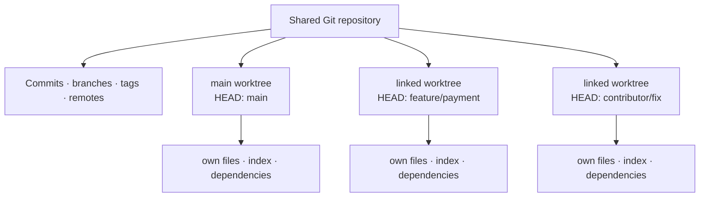
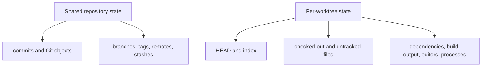
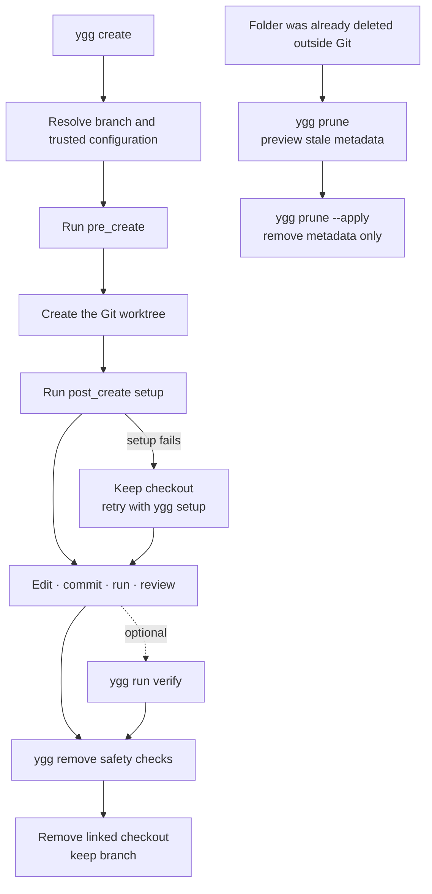

# Worktrees explained

Git worktrees let one repository provide several project folders at the same time. This guide builds
the mental model first, then shows where Ygg fits and how the workflow looks in daily development.

## The four building blocks

| Term | Think of it as | Example |
| --- | --- | --- |
| Repository | The shared Git database and history | Commits, branches, tags, and remotes |
| Branch | A movable name for a line of commits | `main`, `feature/payment` |
| Checkout | Files from one commit written into a folder | The files currently visible in an editor |
| Worktree | One checkout plus its own Git working state | `feature-payment/` with its own `HEAD` and index |

A normal clone combines one repository and one main worktree. Linked worktrees add more checkout
folders without cloning the complete repository again.



In a Ygg standalone workspace, the same relationship is visible on disk:

```text
project/
├── .ygg/                    Ygg workspace metadata and shared local files
├── repo.git/                shared Git objects, refs, remotes, and worktree metadata
├── main/                    files + HEAD + index for main
├── feature-payment/         files + HEAD + index for feature/payment
└── contributor-fix/         files + HEAD + index for contributor/fix
```

Each worktree behaves like a normal repository folder: open it in an editor, run `git status`, edit
files, commit, and start processes there. A commit created in one worktree immediately becomes part
of the shared repository and is visible from the others.

## Shared and independent state



| Action | Effect |
| --- | --- |
| Edit a file | Changes only that worktree's folder. |
| Stage a file | Changes only that worktree's index. |
| Create a commit | Adds the commit to the shared repository. |
| Fetch a remote | Updates shared remote-tracking refs for all worktrees. |
| Install dependencies | Writes into that worktree unless the package manager uses an external cache. |
| Start a server | Starts a separate process, but ports and external services may still conflict. |

## Four everyday workflows

### 1. Fix production without disturbing a feature

**Starting point:** `feature/payment` has uncommitted changes and production needs a fix based on
`release/1.x`.

```sh
ygg create hotfix/payment --from release/1.x --tool code
```

```text
project/
├── feature-payment/         unfinished files remain exactly as they are
└── hotfix-payment/          clean checkout based on release/1.x
```

Commit and publish the hotfix normally. After it is merged:

```sh
ygg remove hotfix-payment
```

The hotfix folder is removed after safety checks. The branch and the feature worktree remain.

### 2. Review a teammate's branch beside your own work

**Starting point:** the configured remote contains `contributor/payment-fix`, the project exposes a
`verify` task, and your current branch must stay open.

```sh
ygg create contributor/payment-fix --tool code
ygg run verify contributor-payment-fix
```

```text
project/
├── feature-payment/             your current work
└── contributor-payment-fix/     review checkout tracking the remote branch
```

When the review is complete:

```sh
ygg remove contributor-payment-fix
```

Ygg fetches according to project configuration and prefers an existing local branch, then a matching
remote branch, before creating a new branch.

### 3. Keep coding while a long test runs

**Starting point:** an experiment or verification job should not occupy the folder used for current
development.

```sh
ygg create experiment/migration
ygg exec experiment-migration -- pnpm test
```

```text
project/
├── main/                    editor and development server stay available
└── experiment-migration/    test process and generated output stay here
```

Continue in `main/` from another terminal. Inspect and remove the experiment when it is no longer
needed:

```sh
ygg remove experiment-migration
```

### 4. Give parallel agents separate files

**Starting point:** two coding tasks must not share staged, unstaged, untracked, or generated files.

```sh
ygg create feature/api
ygg create feature/ui
ygg list
```

```text
project/
├── feature-api/             API agent, commits on feature/api
└── feature-ui/              UI agent, commits on feature/ui
```

Open the agents from separate terminals so foreground tools can run at the same time:

```sh
# Terminal A
ygg open feature-api --tool codex

# Terminal B
ygg open feature-ui --tool codex-app
```

Each agent owns a real checkout. When the project exposes a `verify` task, verify and remove each
task independently:

```sh
ygg run verify feature-api
ygg remove feature-api
ygg run verify feature-ui
ygg remove feature-ui
```

Ygg separates filesystem state; it does not coordinate agent decisions, handoffs, ports, databases,
or other shared services.

## The worktree lifecycle



`remove` is the normal finish path. `prune` is not a faster removal command; it repairs stale Git
administrative state after a registered directory is already missing. Locked registrations are
preserved.

## Workspace layouts

### Flat standalone workspace

This is the recommended default. The shared repository and every worktree are siblings:

```text
project/
├── .ygg/
│   ├── workspace.yml
│   └── shared/
├── repo.git/
├── main/
└── feature-payment/
```

Create it directly from a remote repository:

```sh
ygg init git@github.com:example/project.git ~/dev/project
```

### Grouped standalone workspace

Use a dedicated container when the workspace root should not contain checkout folders directly:

```text
project/
├── .ygg/
├── repo.git/
└── worktrees/
    ├── main/
    └── feature-payment/
```

```sh
ygg init git@github.com:example/project.git ~/dev/project --worktrees-dir worktrees
```

### Retained existing checkout

Guided initialization can keep an existing checkout in place and add a separate worktree container:

```text
~/dev/
├── project/                         protected existing checkout
│   └── .git/ygg/
│       ├── workspace.yml
│       └── shared/
└── project-worktrees/
    ├── .ygg -> ../project/.git/ygg
    └── feature-payment/
```

```sh
cd ~/dev/project
ygg init
```

The wizard suggests a safe target, previews absolute paths and the resulting tree, then asks for
confirmation. The original checkout is never moved or deleted and is protected from `ygg remove`.

Creating a separate standalone workspace from a local repository is different: Ygg copies committed
branch history into independent Git object storage without hardlinks. Uncommitted or ignored files,
stashes, and detached commits without a branch stay in the source repository.

See [Configuration](configuration.md#supported-layouts) for generated paths and layout constraints.

## Ygg and native Git

Ygg does not replace Git. It applies workspace policy around the native operations:

| Intent | Ygg workflow | Native foundation |
| --- | --- | --- |
| Create a checkout | `ygg create <branch>` | `git worktree add` |
| Find all checkouts | `ygg list` | `git worktree list` plus Ygg state |
| Enter a checkout | `ygg cd <worktree>` | Resolve and print its canonical path |
| Run project setup or tasks | `ygg setup`, `ygg run` | Trusted `.ygg.yml` behavior |
| Finish with a checkout | `ygg remove <worktree>` | Safety inspection and `git worktree remove` |
| Clean stale metadata | `ygg prune` | Preview-first `git worktree prune` |

Use Ygg for normal workspace operations so paths, setup, trust, and safety checks stay consistent.
Regular Git commands inside a selected worktree continue to work normally.

## Common questions and pitfalls

### Can the same branch be checked out twice?

Git normally prevents one branch from being checked out in multiple worktrees. Create a separate
branch if two folders need to evolve independently.

### Are worktrees lightweight clones?

They share Git object storage, but every worktree still contains its own checked-out files,
dependencies, and build output. Large repositories and monorepos can therefore use significant disk
space even though Git history is not duplicated.

### Are running applications isolated?

Only their folders and processes are separate. Fixed ports, container names, volumes, databases,
device targets, and cloud resources can still collide. Coordinate those resources or run only one
conflicting environment at a time.

### Can I move or delete a worktree folder manually?

Do not do that for normal cleanup. Git keeps administrative links between the shared repository and
each worktree. Use `ygg remove` so state is inspected first. If a directory is already missing,
preview its stale registration with `ygg prune`.

### Does removing a worktree delete its branch?

No. `ygg remove` removes the linked checkout after safety checks and preserves the branch. `ygg
prune` removes only stale administrative metadata and never deletes an existing directory or branch.

### Do I need a worktree for every branch?

No. Use them when simultaneous folders preserve meaningful context: a hotfix, review, long-running
job, or parallel agent. For a quick isolated change, normal branch switching may be simpler.

## Further reading

- [Official Git worktree documentation](https://git-scm.com/docs/git-worktree)
- [DataCamp: Git Worktree Tutorial](https://www.datacamp.com/tutorial/git-worktree-tutorial)
- [Ygg CLI reference](cli-reference.md)
- [Ygg configuration](configuration.md)
